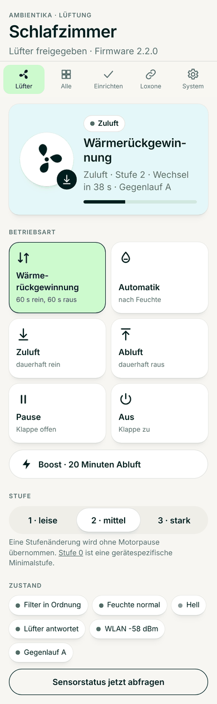
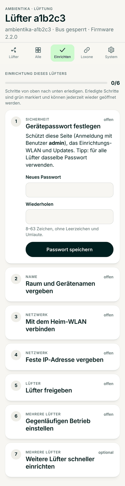
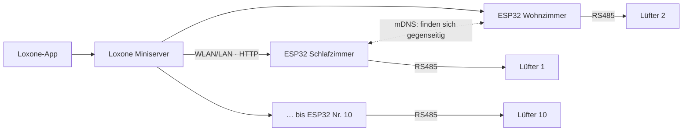
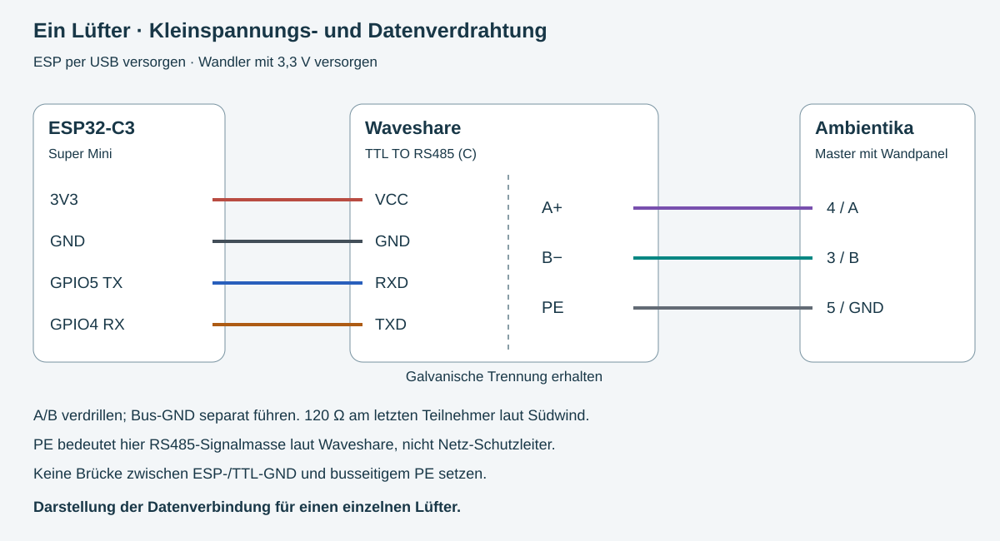

# Ambientika-Lüfter mit ESP32 in Loxone einbinden

Mit dieser Firmware steuerst du **beliebig viele Ambientika-Lüfter** (ausgelegt für
8–10 und mehr) über Loxone, die Loxone-App und eine eigene Bedienseite im Browser. Jeder
Lüfter bekommt einen kleinen **ESP32-C3 Super Mini** mit einem **RS485-Wandler**. Der ESP
übernimmt alles Zeitkritische selbst: den 500-ms-Telegrammtakt, die Motorpausen und
den Wechsel zwischen Zu- und Abluft.

&nbsp;&nbsp;

## Was kann das System?

- **Bedienen** über Loxone, die Loxone-App (auch von unterwegs) und eine Webseite pro Lüfter:
  Wärmerückgewinnung, Automatik (Feuchte, Tag/Nacht), Zuluft, Abluft, Pause, Aus,
  Boost 20 Minuten, Stufe 1–3
- **Mehrere Lüfter gegenläufig:** Lüfter in Gruppe A blasen hinein, während Gruppe B
  hinausbläst, und umgekehrt. Der Takt kommt aus der Uhrzeit, Kabel zwischen den ESPs
  braucht es nicht.
- **Übersicht „Alle Lüfter“:** Jeder ESP findet die anderen im Heimnetz und zeigt ihren
  Zustand. Alle lassen sich gemeinsam schalten.
- **Schnelle Einrichtung:** Ein Assistent führt Schritt für Schritt. Für weitere Lüfter
  gibt es eine Vorlage, damit du WLAN und Passwort nur einmal eintippen musst.
- **Loxone-Vorlagen zum Importieren:** pro Lüfter zwei Dateien mit fertig eingetragener
  Adresse und fertig eingetragenem Schlüssel
- **Rückmeldung an Loxone:** Filterwechsel, Feuchtealarm, Dämmerung, Kommunikationsstatus
- **Betriebssicher:** Weiterlaufen nach Stromausfall, Watchdog bei Hängern, Update über
  den Browser, Ereignisprotokoll zur Fehlersuche, Gerätepasswort

## Los geht's

| Was | Wo |
|---|---|
| **Komplette Schritt-für-Schritt-Anleitung (empfohlen)** | **[docs/ANLEITUNG.md](docs/ANLEITUNG.md)** |
| Firmware aufspielen (USB oder Browser) | [docs/FLASHEN.md](docs/FLASHEN.md) |
| Loxone Config und Loxone-App | [docs/LOXONE.md](docs/LOXONE.md) |
| Wenn etwas nicht klappt | [docs/FEHLERSUCHE.md](docs/FEHLERSUCHE.md) |
| Versionen, Neuerungen, Wechsel v1 ↔ v2 | [docs/VERSIONEN.md](docs/VERSIONEN.md) |
| HTTP-Schnittstelle | [docs/API.md](docs/API.md) |
| Bauen und Testen | [docs/ENTWICKLUNG.md](docs/ENTWICKLUNG.md) |

## Aufbau

- **Ein ESP pro Lüfter.** Die RS485-Leitungen bleiben getrennt, denn das Protokoll kennt
  keine Geräteadressen. Jeder Lüfter wird auf **„Master mit Wandpanel“** gestellt.
- **Alle ESPs bekommen dieselbe Firmware.** Name, Gruppe, IP-Adresse und Schlüssel stellst
  du pro Gerät auf dessen Bedienseite ein.

## Downloads

| Version | Stand | Dateien |
|---|---|---|
| **v2** (aktuell, Firmware 2.2.0) | Mehrlüfter-Version: Gegenlauf, Übersicht, Loxone-Vorlagen, Einrichtungsassistent, neues Design, Protokoll, Web-Update | [dist/v2](dist/v2/) |
| v1 | erste, getestete Version (ein Lüfter, Grundfunktionen) | [dist/v1](dist/v1/) |

Pro Version gibt es drei Dateien. Welche du brauchst, steht in
[docs/FLASHEN.md](docs/FLASHEN.md):
- `…-komplett-0x0.bin` für einen neuen ESP
- `…-update-0xE000.bin` für ein Update per USB, Einstellungen bleiben erhalten
- `…-ota.bin` für ein Update über die Webseite

Technische Eckdaten: ESP32-C3, 4 MB Flash, DIO/40 MHz, USB-CDC, Arduino 2.0.17.

## Verdrahtung (Kurzfassung)

| ESP32-C3 Super Mini | Waveshare TTL TO RS485 (C), TTL-Seite |
|---|---|
| 3V3 | VCC |
| GND | GND |
| GPIO5 / TX | RXD |
| GPIO4 / RX | TXD |

| Waveshare, RS485-Seite | Ambientika |
|---|---|
| A+ | Klemme 4 / A |
| B− | Klemme 3 / B |
| PE (RS485-Signalmasse) | Klemme 5 / GND |

TTL-GND und das busseitige PE bleiben getrennt. A/B verdrillt führen. Den ESP über USB
versorgen. Die ausführliche Fassung mit Hinweisen steht in
[docs/ANLEITUNG.md](docs/ANLEITUNG.md#2-verdrahten).

## Betriebsarten

| Betriebsart | Zahl (Loxone) | Verhalten |
|---|---|---|
| Aus | 0 | Motor aus, Klappe geschlossen |
| Wärmerückgewinnung (WRG) | 1 | 60 s Zuluft, 10 s Pause, 60 s Abluft, 10 s Pause |
| Automatik | 2 | wie WRG, Lüfter regelt nach Feuchte (Stufe 2/3, Tag/Nacht) |
| Zuluft | 3 | dauerhaft hinein, Stufe 0–3 |
| Abluft | 4 | dauerhaft hinaus, Stufe 0–3 |
| Pause | 5 | Motor steht, Klappe offen |
| Boost | 6 | 20 Minuten Abluft Stufe 3, danach die vorherige Betriebsart (auch „Aus“) |

Jeder Start und jeder Richtungswechsel läuft über mindestens 10 Sekunden Motorpause. So
verlangt es der Hersteller. Laut Geräteanleitung braucht die Klappe nach dem Einschalten
der Stromversorgung zusätzlich 40–60 Sekunden zum Öffnen. Eine Rückmeldung zur
Klappenstellung kennt das Protokoll nicht.

## Unterlagen

- [RS485-Anleitung des Herstellers, Juni 2025](docs/reference/installationsanleitung-rs-485-ambientika-juni-25.pdf)
- [Geräteanleitung 2024](docs/reference/instruction-manual-2024-1.pdf)
- [Waveshare TTL TO RS485 (C)](https://www.waveshare.com/wiki/TTL_TO_RS485_(C))
