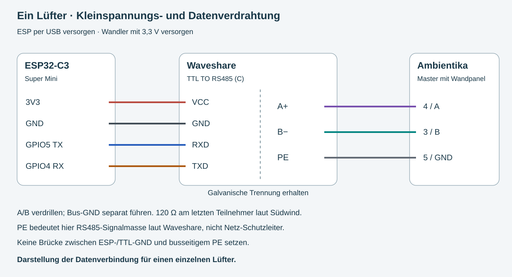

# Ambientika – ESP32-C3 Teststeuerung für einen Lüfter

Flashdatei: `dist/ambientika-c3-single-fan.bin`, Gesamtimage für Adresse **0x0**.
ESP32-C3, 4 MB Flash, DIO/40 MHz, USB-CDC. GPIO4 RX / GPIO5 TX.
Build und simulierte Steuerungslogik sind geprüft. Noch kein Test am echten
ESP32, Wandler oder Lüfter: erste Inbetriebnahme beaufsichtigen.

## Schnellstart und Dokumentation

1. [Komplettpaket herunterladen](dist/ambientika-c3-testpaket.zip) und entpacken.
2. [Mit grafischem Programm flashen – ohne Python](docs/FLASHEN.md).
3. [Verdrahtungsskizze](docs/verdrahtung.svg) und Anschlussangaben unten beachten.
4. [WLAN und ersten Lüfter einrichten](#3-einrichten--ohne-usb-terminal).
5. [Loxone Schritt für Schritt anbinden](docs/LOXONE.md).

Die lokale ESP-Webseite dient sowohl zur Einrichtung als auch zur laufenden
Bedienung. Loxone steuert dieselbe Firmware direkt per HTTP; die Webseite muss
dafür nicht geöffnet sein. Der ESP übernimmt die zeitliche Lüftersteuerung.



Herstellerunterlagen: [RS485-Anleitung Juni 2025](docs/reference/installationsanleitung-rs-485-ambientika-juni-25.pdf)
und [Geräteanleitung 2024](docs/reference/instruction-manual-2024-1.pdf).
Die PDFs sind bereitgestellte Herstellerunterlagen, keine eigenen Prüfnachweise.

## 1. Verdrahtung

Nur spannungsfrei arbeiten. Netzspannungsanschlüsse durch Elektrofachkraft.
Diese Anleitung betrifft die Kleinspannungs-/Datenverbindung. Sie basiert auf
Südwind „Programmierung über RS485“, Juni 2025, und dem Waveshare-Wiki für
**TTL TO RS485 (C)**. Geräteanschlüsse vor Ort mit der Anleitung abgleichen.

| ESP32-C3 Super Mini | Waveshare TTL-Seite |
|---|---|
| 3.3 / 3V3 | VCC |
| G / GND | GND |
| GPIO5 | RXD |
| GPIO4 | TXD |

Wandler mit 3,3 V versorgen, damit die TTL-Pegel zum ESP passen. Kein 5-V-Signal
an ESP-GPIOs anschließen. ESP über ein USB-Netzteil versorgen.

| Waveshare Bus-Seite | Ambientika-Klemme |
|---|---|
| A+ | 4 / A |
| B− | 3 / B |
| PE | 5 / GND |

Waveshare bezeichnet PE bei diesem Modell ausdrücklich als **RS485 Signal Ground**.
Die Bezeichnung ist hier kein Auftrag, sie an den Netz-Schutzleiter anzuschließen.
Keine zusätzliche Verbindung zwischen TTL-GND und PE: galvanische Trennung erhalten.
Quelle: https://www.waveshare.com/wiki/TTL_TO_RS485_(C)

Verdrillte A/B-Leitung und separater Bus-GND, keine Datenleitung als Schutzleiter
nutzen. 120-Ohm-Abschluss am letzten Busteilnehmer gemäß Südwind; vorhandene
Widerstände prüfen, nicht beliebig weitere parallel ergänzen. Waveshare beschreibt
je nach Ausführung Lötbrücke/Schalter für den eigenen 120-Ohm-Abschluss.

Ein Testlüfter als **Master mit Wandpanel** konfigurieren: die beiden
Master/Slave-DIP-Schalter auf ON/ON, entsprechend Abbildung auf Seite 2 der
RS485-Anleitung. Mit spannungsfreiem Gerät einstellen. Kein zusätzliches sendendes
Wandpanel/anderer Buscontroller am selben Testbus.

## 2. Flashen

**Empfohlen:** [grafischer Browser-Flasher von Espressif](docs/FLASHEN.md).
Damit ist keine Python-Installation nötig. Die folgenden Befehle sind eine Alternative.

### Alternative: Windows mit Python

USB-Datenkabel erforderlich. Python installieren, dann in PowerShell:

```powershell
py -m pip install esptool==4.5.1 pyserial
py -m esptool --chip esp32c3 --port COM5 flash_id
py -m esptool --chip esp32c3 --port COM5 --baud 460800 write_flash 0x0 ambientika-c3-single-fan.bin
```

COM5 durch den Port im Gerätemanager ersetzen; in den Ordner mit der Binary wechseln.
`flash_id` muss ESP32-C3/4-MB-Hardware bestätigen. Bei Verbindungsproblemen:
BOOT gedrückt halten, RESET kurz drücken, BOOT loslassen und erneut verbinden.
Nach dem Flashen RESET ohne BOOT drücken. Falls nötig Baudrate 115200 benutzen.
Unter Linux/macOS `python3` statt `py`, Port z. B. `/dev/ttyACM0`.

Das Gesamtimage enthält Bootloader, Partitionstabelle, OTA-Initialisierung und
Anwendung. Erneutes Flashen dieses Gesamtimages überschreibt auch den
Konfigurationsbereich: WLAN-Einrichtung danach erneut durchführen.
Nicht die einzelne `.pio/.../firmware.bin` an Adresse 0 schreiben.

## 3. Einrichten – ohne USB-Terminal

1. Nach dem Flashen RESET drücken. Auf Handy oder PC mit **Ambientika-…**
   verbinden, Passwort **Lueftung-Start**. Einrichtungs-WLAN maximal zehn Minuten
   offen lassen; bei abgelaufener Zeit ESP neu starten. Das gemeinsame
   Einrichtungspasswort ist nur eine Zugangshürde: während Einrichtung können
   Personen in Funkreichweite mit diesem Passwort die lokale Konfiguration ändern.
2. Im Browser **http://192.168.4.1** öffnen. Falls das Handy „kein Internet“ meldet,
   dieses WLAN trotzdem beibehalten, gegebenenfalls Mobilfunk kurz deaktivieren.
3. Unter „1 · Heim-WLAN verbinden“ WLAN-Name und Passwort des **2,4-GHz-Netzes**
   eintragen. „WLAN verbinden“ drücken. Die Verbindung wird ohne Neustart aufgebaut.
   Ein nichtleeres WLAN-Passwort muss 8–63 Zeichen haben.
4. Auf die Meldung „Heim-WLAN verbunden“ warten und die dort genannte neue
   IP-Adresse notieren. Der Einrichtungs-AP schließt frühestens etwa 60 Sekunden
   nach dem Speichern, sobald das Heim-WLAN verbunden ist. Ohne Verbindung
   bleibt er bis zum Ablauf des Zehn-Minuten-Fensters verfügbar.
5. PC/Handy ins Heim-WLAN zurückschalten und die notierte IP im Browser öffnen.
   Alternativ IP im Router suchen. Im Router eine feste DHCP-Zuordnung einrichten.
   Nach WLAN-Ausfall öffnet der ESP nach etwa einer Minute ein zeitbegrenztes
   Einrichtungs-WLAN, sofern das Fenster nicht schon abgelaufen ist. Neustart
   öffnet ein neues Fenster. Falsche Zugangsdaten lassen sich dort korrigieren.
6. Unter „2 · Lüfter freigeben“ erst nach Kontrolle der Verdrahtung und
   DIP-Schalter „Verdrahtung geprüft – freigeben“ drücken. Zunächst wird Aus gesendet.
7. Unter „3 · Lüftung bedienen“ **Wärmerückgewinnung**, **Stufe 1** wählen und
   „Übernehmen“ drücken. Nach mindestens zehn Sekunden Pause läuft der Lüfter
   60 Sekunden in Zuluft, pausiert mindestens zehn Sekunden, läuft 60 Sekunden
   in Abluft und wiederholt den Zyklus. Mindestens zwei volle Zyklen beobachten.
8. „Sensorstatus abfragen“ drücken. Nach drei Sekunden sollten Werte mit Alter
   der letzten Geräteantwort erscheinen. Keine Antwort bedeutet unbestätigte
   Kommunikation; HTTP-Erfolg allein bestätigt nur die Annahme durch den ESP.
9. „Aus wählen“ testen. Dann mindestens eine Sekunde warten. Erst nach Versand
   des Aus-Telegramms lässt sich „Busausgabe sperren“ verwenden. Bei laufender
   Statusabfrage kann das Aus-Telegramm bis zum Ende der Drei-Sekunden-Sperre warten.
   Sperren ist kein Not-Aus und bestätigt keinen mechanischen Stillstand.
10. Boost und anschließend Neustart testen: Boost endet nach 20 Minuten
    Motorfreigabe mit Rückkehr zur vorherigen Betriebsart samt Einstellungen.
    Neustart wählt Aus, niemals automatisch den vorherigen Boost/WRG-Betrieb.

Richtung, Pausenzeiten, Gerätereaktion bei Strom-/ESP-Ausfall und WLAN/Loxone-
Verbindung müssen vor unbeaufsichtigtem Betrieb am echten Gerät geprüft werden.
USB-Seriell bleibt zur Diagnose verfügbar: 115200 Baud, `i` zeigt AP/IP/API-Schlüssel.

## 4. Betriebsarten und Verhalten

- **wrg**: manueller Wechselzyklus, Stufen 0–3. Startempfehlung für den Test:
  Stufe 1. Welche Leistung im Haus nötig ist, ergibt sich aus dem Lüftungskonzept.
- **auto**: gleicher externer Wechselzyklus mit dokumentierten Automatiktelegrammen;
  Tag/Nacht und Feuchtestufe 2/3. Sensorprioritäten bestimmt die Lüfterelektronik.
- **supply / extract**: dauerhafte Zu-/Abluft, Stufen 0–3, ohne Wechsel-WRG.
- **boost**: Abluft Stufe 3 für 20 Minuten ab Motorfreigabe, danach vorheriger
  Modus bzw. WRG, wenn vorher Aus/Pause. Vor Umschaltung mindestens 10 s Pause.
- **pause**: Motorpause, Klappe offen. **off**: Motor aus, Klappe geschlossen.
  Stufe 0 ist ausdrücklich nicht derselbe Befehl wie off.

Betriebsbefehle alle 500 ms. Wiederholungen identischer Loxone-Befehle verlängern
laufenden Boost oder Zyklus nicht. Nach Ablauf würde ein erneut gesendeter
Boost-Befehl einen neuen Boost starten: Loxone deshalb auf Schaltflanken auslegen.
Bei WLAN/Loxone-Ausfall läuft der gewählte Modus lokal weiter, Boost endet lokal.
Nach ESP-Neustart wird **Aus** gewählt; Busfreigabe bleibt gespeichert.
Bei Strom-/ESP-Ausfall kann der ESP keine Befehle senden: die Reaktion des Lüfters
auf Kommunikationsverlust muss am Gerät geprüft werden.

## 5. Loxone – virtuelle HTTP-Ausgänge

Die vollständige Anleitung mit Ausgangs-Konfiguration, Schaltflanken,
Bedienprioritäten und Grenzen der Rückmeldung steht in [docs/LOXONE.md](docs/LOXONE.md).

Es wird keine Loxone RS485 Extension benötigt: der ESP übernimmt die serielle
Ausgabe. IP im Router fest reservieren. Beispiel für einen virtuellen HTTP-Ausgang:

`http://IP/api/control?key=KEY&mode=wrg&level=1`

Weitere Beispiele (IP und KEY ersetzen):

| Funktion | Pfad |
|---|---|
| Aus | `/api/control?key=KEY&mode=off` |
| Nacht-Automatik | `/api/control?key=KEY&mode=auto&humidity=2&night=1` |
| Tag-Automatik | `/api/control?key=KEY&mode=auto&humidity=2&night=0` |
| Boost | `/api/control?key=KEY&mode=boost` |
| Abluft Stufe 2 | `/api/control?key=KEY&mode=extract&level=2` |
| Zuluft Stufe 1 | `/api/control?key=KEY&mode=supply&level=1` |

Steuerung akzeptiert GET (für Loxone) und POST. Alternativ Schlüssel per
`X-API-Key`-Header. `/api/status` liefert JSON mit angefordertem Modus,
Zyklusphase und letzten Sensorflags. Fehlende Sensorwerte sind -1;
`device_status_received` und `status_age_ms` zeigen Empfang und Alter an.
Kein Wert bestätigt tatsächliche Motordrehzahl oder Luftleistung.
`POST /api/query?key=KEY` fordert Sensorstatus an; danach wird 3 s nichts gesendet.
Die Anleitung nennt 11 Byte, zeigt aber 12: implementiert ist der abgebildete
Rahmen STX + `00` + acht binäre ASCII-Statusstellen + ETX.
Filterreset wird nicht automatisch ausgeführt.

Unter „4 · Mit Loxone verbinden“ kann eine fertige Befehlsadresse ausgewählt
und kopiert werden. Bei HTTP ohne Clipboard-Unterstützung das markierte Feld
manuell kopieren.

Nur im vertrauenswürdigen lokalen Netz einsetzen: HTTP ist unverschlüsselt,
Webseite inklusive API-Schlüssel und Status sind lokal ohne Anmeldung erreichbar.
Keine Portweiterleitung ins Internet einrichten.

## 6. Entwicklung und Prüfungen

```sh
python -m venv /workspace/ambientika-tools
/workspace/ambientika-tools/bin/pip install platformio==6.1.18
cd /workspace/ESP32-C3-Super-Mini-L-ftungssteuerung
bash scripts/build.sh
g++ -std=c++17 -I tests/native tests/native/test.cpp -o /tmp/ambientika-native-tests
/tmp/ambientika-native-tests
```

Pinned PlatformIO ESP32-Plattform 6.10.0 / Arduino 2.0.17. Native Tests führen
Original-Handler und Original-loop mit simuliertem UART, Webserver und Zeit aus:
Busfreigabe, Authentifizierung, Parameter, WRG-Zyklus, volle Motorpause,
wiederholte Befehle, Boost-Ende, Status, 3-s-Sendesperre, Aus, Zeitüberlauf, WLAN-Wiederherstellung, beschädigte Statusrahmen,
Boost-Einstellungswiederherstellung und Betriebstelegramme. Zusätzlich läuft
der native Test mit AddressSanitizer und UndefinedBehaviorSanitizer; JavaScript
wird mit node --check auf Syntax geprüft. Sie ersetzen keinen Hardware-/WLAN-Test.
Buildscript prüft Imagebestandteile und Offsets; `dist/SHA256SUMS` enthält den Hash.

Quellen: hochgeladene Südwind-RS485-Anleitung Juni 2025, Geräteanleitung 2024,
https://github.com/ambientika-eu/ambientika-rs485-boost-button und Waveshare-Wiki.

## Acht Lüfter später

Dieser Prototyp steuert einen Master bzw. eine gemeinsame Master/Slave-Gruppe.
Das dokumentierte Protokoll enthält keine Raumadressen. Acht einzeln regelbare
Räume brauchen ein separates Bus-/Gatewaykonzept. Paarung, gegenläufige Slaves,
Luftwege und Luftmengen müssen zum Lüftungskonzept passen; ein einzelner
wechselnder Lüfter stellt keine gleichzeitig ausgeglichene Zu-/Abluft her.
