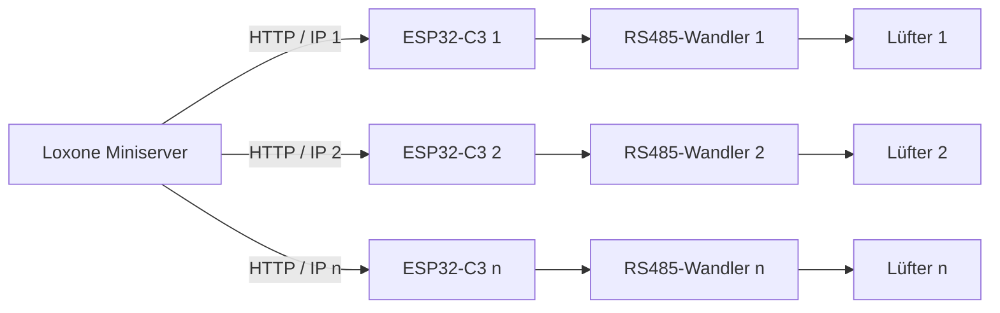

# Ambientika einzeln über ESP32 und Loxone steuern

Jeder Lüfter erhält einen eigenen **ESP32-C3 Super Mini** und einen eigenen
**Waveshare TTL TO RS485 (C)**. Jeder ESP hat eine eigene IP-Adresse, einen eigenen
API-Schlüssel und eine eigene Bedienseite. Loxone steuert jeden Lüfter separat.
Auf allen ESPs wird dieselbe Firmware verwendet.

## Aufbau

Die RS485-Verbindungen bleiben je Lüfter getrennt. Das dokumentierte Protokoll
hat keine individuellen Geräteadressen. Die Einstellung **„Master mit Wandpanel“**
ist an jedem einzelnen Lüfter erforderlich, damit er Steuerbefehle empfängt;
es werden keine Slave-Lüfter verbunden.

## Versionen und Downloads

| Version | Stand | Dateien |
|---|---|---|
| **v2** (aktuell) | Gerätepasswort, Web-Update, Filter-Reset, Wiederanlauf nach Stromausfall, Loxone-Rückmeldung, feste IP | [dist/v2](dist/v2/) |
| v1 | erste Version | [dist/v1](dist/v1/) |

Was sich geändert hat und wie du zwischen v1 und v2 wechselst: [docs/VERSIONEN.md](docs/VERSIONEN.md)

- [Flashen (USB oder Webseite)](docs/FLASHEN.md)
- [Loxone-Integration mit fester IP und App](docs/LOXONE.md)
- [HTTP-API](docs/API.md)

Firmware: ESP32-C3, 4 MB Flash, DIO/40 MHz, USB-CDC.

## 1. Verdrahtung je Lüfter

| ESP32-C3 Super Mini | Waveshare TTL-Seite |
|---|---|
| 3V3 | VCC |
| GND | GND |
| GPIO5 / TX | RXD |
| GPIO4 / RX | TXD |

ESP über USB versorgen. Wandler-Versorgung und TTL-Pegel: 3,3 V.

| Waveshare RS485-Seite | Ambientika |
|---|---|
| A+ | Klemme 4 / A |
| B− | Klemme 3 / B |
| PE / RS485-Signalmasse | Klemme 5 / GND |

TTL-GND und busseitiges PE bleiben getrennt. A/B verdrillen, Busmasse separat
führen. 120-Ohm-Abschluss gemäß Herstelleranleitung am Busende vorsehen;
vorhandenen Abschluss am Wandler berücksichtigen.

Jeden Lüfter auf **„Master mit Wandpanel“** einstellen: die beiden zugehörigen
DIP-Schalter ON/ON, entsprechend Seite 2 der RS485-Anleitung.

## 2. Flashen

Neuer ESP: `dist/v2/ambientika-c3-v2-komplett-0x0.bin` mit dem
[Espressif Browser-Flasher](https://espressif.github.io/esptool-js/) an **0x0** flashen.
ESP mit v1: `ambientika-c3-v2-update-0xE000.bin` an **0xE000** – dann bleiben WLAN und
API-Schlüssel erhalten. Später geht jedes Update über die Weboberfläche.
Details: [docs/FLASHEN.md](docs/FLASHEN.md).

## 3. Einrichten

Für jeden ESP nacheinander:

1. Mit dem WLAN **Ambientika-…** verbinden. Passwort: **Lueftung-Start** (gilt nur bis
   zur Einrichtung).
2. **http://192.168.4.1** öffnen.
3. Unter **1** ein eigenes **Gerätepasswort** festlegen (danach Anmeldung mit Benutzer
   `admin`; das Einrichtungs-WLAN nutzt ab dem nächsten Start ebenfalls dieses Passwort).
4. Unter **1** das 2,4-GHz-Heim-WLAN eintragen. Die angezeigte neue Adresse notieren,
   ins Heim-WLAN wechseln und sie öffnen.
5. Unter **2** einen Gerätenamen vergeben (z. B. `lueftung-bad`) und im Router eine feste
   IP zuordnen – Schritt für Schritt in [docs/LOXONE.md](docs/LOXONE.md#1-feste-ip-adresse-vergeben).
6. Unter **3** nach Prüfung der Verdrahtung den Bus freigeben.
7. Unter **4** z. B. **Wärmerückgewinnung, Stufe 1** wählen und am Lüfter prüfen.
8. Loxone einrichten: [docs/LOXONE.md](docs/LOXONE.md).

Das Einrichtungs-WLAN öffnet sich nur, solange kein WLAN gespeichert ist oder wenn das
Heim-WLAN länger als 2 Minuten nicht erreichbar ist; es schließt eine Minute nach
erfolgreicher Verbindung. **Passwort vergessen oder Netzwerk verstellt:** BOOT-Taster am ESP
10 Sekunden halten (WLAN, Passwort und Netzwerk werden gelöscht; API-Schlüssel und
Freigabe bleiben).

## 4. Betriebsarten

| Betriebsart | Zahl | Verhalten |
|---|---|---|
| `off` | 0 | Motor aus, Klappe geschlossen |
| `wrg` | 1 | 60 s Zuluft, 10 s Pause, 60 s Abluft, 10 s Pause |
| `auto` | 2 | Wechselzyklus mit Automatiktelegrammen, Tag/Nacht und Feuchtestufe 2/3 |
| `supply` | 3 | Dauerhafte Zuluft, Stufe 0–3 |
| `extract` | 4 | Dauerhafte Abluft, Stufe 0–3 |
| `pause` | 5 | Motorpause, Klappe offen |
| `boost` | 6 | 20 Minuten Abluft Stufe 3, danach vorherige Betriebsart (auch „Aus“) |

Der ESP sendet die Telegramme im 500-ms-Takt und übernimmt alle Motorpausen selbst.
Stufe 0 ist nicht gleich `off`. Nach einem Neustart fährt der ESP die zuletzt gewählte
Betriebsart wieder an (abschaltbar, Boost ausgenommen). Bei WLAN-/Loxone-Ausfall läuft die
lokale Steuerung weiter. Der Sensorstatus (Filter, Feuchte, Dämmerung) wird alle 5 Minuten
abgefragt; der Filteralarm lässt sich über Webseite oder Loxone zurücksetzen.

Mehrere ESPs führen ihre Wechselzyklen unabhängig aus. Eine synchronisierte
oder gegenläufige Paarsteuerung über mehrere ESPs ist nicht implementiert.

### Automatischer Verschluss

Im Lüftungsbetrieb ist die Frontklappe geöffnet. `pause` hält sie offen, `off` fordert das
Schließen an. Laut Geräteanleitung braucht der Verschluss nach dem Einschalten der
Stromversorgung etwa 40–60 Sekunden zum Öffnen, bevor der Lüfter startet – unabhängig von
der zehnsekündigen Motorpause der Firmware. Eine Klappenpositionsrückmeldung gibt das
Protokoll nicht her. Ein Stromausfall entspricht keinem gesendeten `off`-Befehl.

## 5. Loxone

Kurzfassung: feste IP vergeben → in Loxone Config je Lüfter einen **Virtuellen Ausgang**
(`http://ESP-IP`) mit Befehlen wie `/api/control?key=KEY&mode=<v>` (Radiotasten) und einen
**Virtuellen HTTP Eingang** (`http://ESP-IP/api/loxone`) für die Rückmeldung anlegen,
Raum/Kategorie setzen → in der App bedienen.

**[Ausführliche Anleitung mit Router, Loxone Config und App](docs/LOXONE.md)**

## Unterlagen und Entwicklung

- [RS485-Anleitung Juni 2025](docs/reference/installationsanleitung-rs-485-ambientika-juni-25.pdf)
- [Geräteanleitung 2024](docs/reference/instruction-manual-2024-1.pdf)
- [Waveshare Anschlussbeschreibung](https://www.waveshare.com/wiki/TTL_TO_RS485_(C))
- [Build und Tests](docs/ENTWICKLUNG.md)
- [Versionen und Änderungen](docs/VERSIONEN.md)
