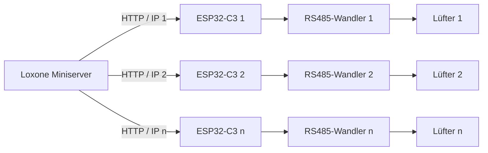

# Ambientika einzeln über ESP32 und Loxone steuern

Jeder Lüfter erhält einen eigenen **ESP32-C3 Super Mini** und einen eigenen
**Waveshare TTL TO RS485 (C)**. Jeder ESP hat eine eigene IP-Adresse, einen eigenen
API-Schlüssel und eine eigene Bedienseite. Loxone steuert jeden Lüfter separat.
Auf allen ESPs wird dieselbe Firmware verwendet.

## Aufbau

Die RS485-Verbindungen bleiben je Lüfter getrennt. Das dokumentierte Protokoll
hat keine individuellen Geräteadressen. Die Einstellung **„Master mit Wandpanel“**
ist an jedem einzelnen Lüfter erforderlich, damit er Steuerbefehle empfängt;
es werden keine Slave-Lüfter verbunden.

## Downloads

- [Komplettpaket mit Firmware, Anleitung und Quellcode](dist/ambientika-c3-testpaket.zip)
- [Firmware-Binary](dist/ambientika-c3-single-fan.bin)
- [Grafisch flashen](docs/FLASHEN.md)
- [Loxone einrichten](docs/LOXONE.md)

Firmware: ESP32-C3, 4 MB Flash, DIO/40 MHz, USB-CDC. Gesamtimage an **0x0** flashen.

## 1. Verdrahtung je Lüfter

| ESP32-C3 Super Mini | Waveshare TTL-Seite |
|---|---|
| 3V3 | VCC |
| GND | GND |
| GPIO5 / TX | RXD |
| GPIO4 / RX | TXD |

ESP über USB versorgen. Wandler-Versorgung und TTL-Pegel: 3,3 V.

| Waveshare RS485-Seite | Ambientika |
|---|---|
| A+ | Klemme 4 / A |
| B− | Klemme 3 / B |
| PE / RS485-Signalmasse | Klemme 5 / GND |

TTL-GND und busseitiges PE bleiben getrennt. A/B verdrillen, Busmasse separat
führen. 120-Ohm-Abschluss gemäß Herstelleranleitung am Busende vorsehen;
vorhandenen Abschluss am Wandler berücksichtigen.

Jeden Lüfter auf **„Master mit Wandpanel“** einstellen: die beiden zugehörigen
DIP-Schalter ON/ON, entsprechend Seite 2 der RS485-Anleitung.

## 2. Flashen

[Espressif Browser-Flasher](https://espressif.github.io/esptool-js/) in Chrome
oder Edge am PC öffnen. ESP per USB anschließen, **Connect** wählen, die Binary
mit **Flash Address 0x0** hinzufügen und **Program** drücken. Anschließend
**Disconnect** und am ESP **RESET** drücken.

Die [Flash-Anleitung](docs/FLASHEN.md) enthält alle Einstellungen und eine
Alternative als installiertes Windows-Programm.

## 3. Einrichten – ohne USB-Terminal

Für jeden ESP nacheinander durchführen:

1. Mit **Ambientika-…** verbinden. Passwort: **Lueftung-Start**.
2. **http://192.168.4.1** im Browser öffnen.
3. Unter **1 · Heim-WLAN verbinden** Name und Passwort des 2,4-GHz-WLANs
   eintragen und **WLAN verbinden** drücken.
4. Die angezeigte neue IP-Adresse notieren. Ins Heim-WLAN wechseln und diese
   IP im Browser öffnen. Alternativ die IP im Router nachsehen.
5. Im Router eine feste DHCP-Zuordnung für diesen ESP anlegen.
6. Unter **2 · Lüfter freigeben** die Busausgabe freigeben.
7. Unter **3 · Lüftung bedienen** beispielsweise **Wärmerückgewinnung,
   Stufe 1** wählen und **Übernehmen** drücken.
8. Unter **4 · Mit Loxone verbinden** die Befehlsadressen für diesen Lüfter kopieren.
9. IP-Adresse und API-Schlüssel dem jeweiligen Lüfter in Loxone zuordnen.

Das Einrichtungs-WLAN schließt bei erfolgreicher Verbindung nach etwa einer
Minute, sonst nach zehn Minuten. Ein Neustart öffnet es erneut. Bei WLAN-Ausfall
öffnet der ESP nach etwa einer Minute ein zeitbegrenztes Einrichtungs-WLAN,
sofern dessen Zeitfenster nicht bereits abgelaufen ist.

Die Webseite bleibt im Heimnetz unter der jeweiligen ESP-IP zur Einrichtung und
Bedienung erreichbar. Für die Steuerung durch Loxone muss sie nicht geöffnet sein.

## 4. Betriebsarten

| Betriebsart | Verhalten |
|---|---|
| `wrg` | 60 s Zuluft, 10 s Pause, 60 s Abluft, 10 s Pause |
| `auto` | Wechselzyklus mit Automatiktelegrammen, Tag/Nacht und Feuchtestufe 2/3 |
| `supply` | Dauerhafte Zuluft, Stufe 0–3 |
| `extract` | Dauerhafte Abluft, Stufe 0–3 |
| `boost` | 20 Minuten Abluft Stufe 3, danach vorherige Betriebsart und Einstellungen |
| `pause` | Motorpause, Klappe offen |
| `off` | Motor aus, Klappe geschlossen |

Der ESP übernimmt Telegramme im 500-ms-Takt und die Motorpausen. Stufe 0 ist
nicht gleich `off`. Nach Neustart wird `off` gewählt, die Busfreigabe bleibt gespeichert.
Bei WLAN-/Loxone-Ausfall läuft die lokale Steuerung weiter. Zum Sperren der
Busausgabe zuerst `off` wählen und den Versand des Aus-Befehls abwarten.

Mehrere ESPs führen ihre Wechselzyklen unabhängig aus. Eine synchronisierte
oder gegenläufige Paarsteuerung über mehrere ESPs ist nicht implementiert.

## 5. Loxone

Pro Lüfter einen virtuellen HTTP-Ausgang mit dessen ESP-IP anlegen. Darunter
Befehle für WRG, Automatik, Boost und Aus hinterlegen. Beispiel:

`http://ESP-IP/api/control?key=API-SCHLUESSEL&mode=wrg&level=1`

[Schritt-für-Schritt-Anleitung und Befehlstabelle](docs/LOXONE.md).

## Unterlagen und Entwicklung

- [RS485-Anleitung Juni 2025](docs/reference/installationsanleitung-rs-485-ambientika-juni-25.pdf)
- [Geräteanleitung 2024](docs/reference/instruction-manual-2024-1.pdf)
- [Waveshare Anschlussbeschreibung](https://www.waveshare.com/wiki/TTL_TO_RS485_(C))
- [Build und Tests](docs/ENTWICKLUNG.md)
