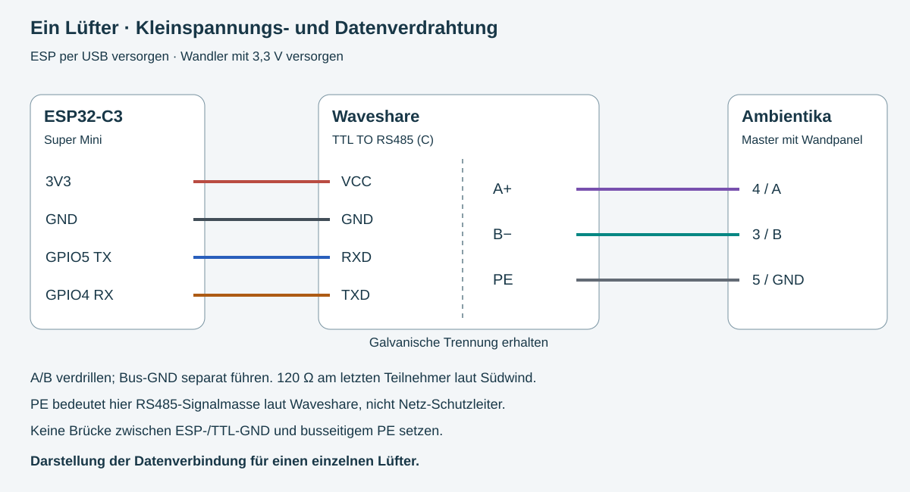
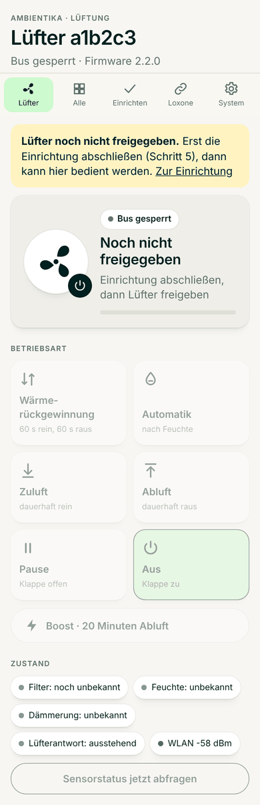
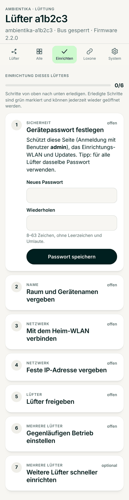
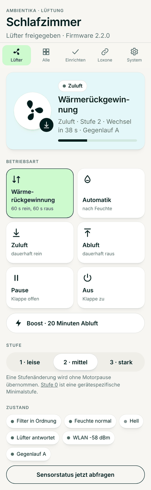
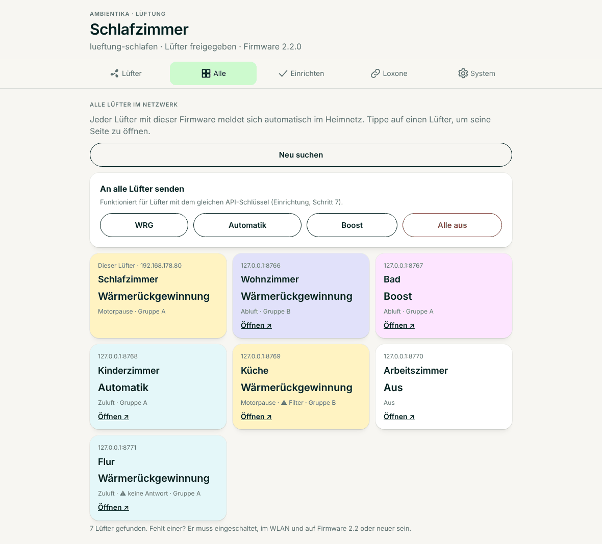

# Schritt-für-Schritt: 8–10 Ambientika-Lüfter in Loxone einbinden

Diese Anleitung führt dich vom Auspacken bis zur Bedienung in der Loxone-App. Sie ist
für Firmware **v2 (2.2.1)** geschrieben und gilt genauso für einen einzelnen Lüfter.

**Zeitbedarf:** erster Lüfter etwa 45 Minuten. Mit der Vorlage aus Schritt 6 brauchst
du für jeden weiteren Lüfter etwa 10 Minuten, plus Verdrahtung.

| | Schritt | erledigt? |
|---|---|---|
| 1 | [Material besorgen](#1-material) | ☐ |
| 2 | [Verdrahten](#2-verdrahten) | ☐ |
| 3 | [Planen: Namen, IP-Adressen, Gruppen](#3-planen) | ☐ |
| 4 | [Firmware aufspielen](#4-firmware-aufspielen) | ☐ |
| 5 | [Ersten Lüfter einrichten](#5-ersten-lüfter-einrichten) | ☐ |
| 6 | [Weitere Lüfter einrichten](#6-weitere-lüfter-einrichten) | ☐ |
| 7 | [Loxone und App](#7-loxone-und-app) | ☐ |
| 8 | [Abschlusstest](#8-abschlusstest) | ☐ |

Du hast schon **v1** auf einem ESP laufen? Dann lies zuerst
[Umstieg von v1](#umstieg-von-v1).

---

## 1. Material

**Pro Lüfter:**

| Teil | Hinweis |
|---|---|
| ESP32-C3 Super Mini | mit USB-C |
| Waveshare **TTL TO RS485 (C)** | galvanisch getrennt, 3,3 V tauglich |
| USB-Netzteil (5 V, ≥ 1 A) + USB-C-Kabel | Versorgung des ESP; ein schwaches Netzteil führt zu Neustarts (das Protokoll zeigt dann „Unterspannung“) |
| 4 kurze Litzen (Dupont) | ESP ↔ Wandler |
| verdrillte Zweidrahtleitung + Masse | Wandler ↔ Lüfter (z. B. J-Y(St)Y 2×2×0,6) |

**Einmalig:**
- PC mit **Chrome oder Edge** (zum Flashen über den Browser)
- Smartphone (für die Einrichtung im Einrichtungs-WLAN)
- Zugang zur Router-Oberfläche (z. B. FRITZ!Box) und zu Loxone Config

---

## 2. Verdrahten

> ⚠️ Lüfter vor allen Arbeiten **spannungsfrei** schalten. Arbeiten am 230-V-Anschluss
> nur durch eine Elektrofachkraft.

**ESP ↔ Wandler (TTL-Seite):**

| ESP32-C3 Super Mini | Waveshare TTL-Seite |
|---|---|
| 3V3 | VCC |
| GND | GND |
| GPIO5 (TX) | RXD |
| GPIO4 (RX) | TXD |

**Wandler (RS485-Seite) ↔ Lüfter:**

| Waveshare RS485-Seite | Ambientika-Klemme |
|---|---|
| A+ | 4 (A) |
| B− | 3 (B) |
| PE (RS485-Signalmasse, kein Schutzleiter!) | 5 (GND) |

**Am Lüfter (DIP-Schalter):** auf **„Master mit Wandpanel“** stellen. Das sind die beiden
zugehörigen DIP-Schalter ON/ON, siehe Seite 2 der
[RS485-Anleitung](reference/installationsanleitung-rs-485-ambientika-juni-25.pdf).

**Wichtig:**
- Jeder Lüfter hat seine **eigene** RS485-Leitung zu seinem **eigenen** ESP. Es dürfen
  weder ein Wandpanel noch weitere Lüfter an derselben Leitung hängen.
- TTL-GND (ESP-Seite) und PE (Busseite) **nicht** verbinden, sonst geht die galvanische
  Trennung verloren.
- A/B verdrillt führen. Kommt später keine Antwort vom Lüfter, ist die häufigste Ursache
  vertauschtes A/B.
- Den 120-Ω-Abschluss nach Herstelleranleitung setzen (bei einer kurzen
  Punkt-zu-Punkt-Leitung meist am Wandler bereits vorhanden).

---

## 3. Planen

Bei 8–10 Lüftern lohnt sich eine kleine Tabelle, **bevor** du anfängst. Drucke sie aus
oder lege sie in Loxone als Notiz ab.

| Nr. | Raum (Anzeigename) | Gerätename | Feste IP | Gruppe | Partner |
|---|---|---|---|---|---|
| 1 | Schlafzimmer | `lueftung-schlafen` | 192.168.178.80 | A | Flur |
| 2 | Flur | `lueftung-flur` | 192.168.178.81 | B | Schlafzimmer |
| 3 | Wohnzimmer | `lueftung-wohnen` | 192.168.178.82 | A | Küche |
| 4 | Küche | `lueftung-kueche` | 192.168.178.83 | B | Wohnzimmer |
| 5 | Kinderzimmer 1 | `lueftung-kind1` | 192.168.178.84 | A | Kinderzimmer 2 |
| 6 | Kinderzimmer 2 | `lueftung-kind2` | 192.168.178.85 | B | Kinderzimmer 1 |
| 7 | Arbeitszimmer | `lueftung-buero` | 192.168.178.86 | A | Bad |
| 8 | Bad | `lueftung-bad` | 192.168.178.87 | B | Arbeitszimmer |
| 9 | … | … | 192.168.178.88 | … | … |
| 10 | … | … | 192.168.178.89 | … | … |

**Gerätename:** nur a–z, 0–9 und Bindestrich, ohne Umlaute. Unter diesem Namen erscheint
der ESP im Router.

**Feste IP:** am besten ein zusammenhängender Block, damit du in Loxone den Überblick
behältst. Wie du sie vergibst, steht in Schritt 5.4.

**Gruppen A/B (Gegenlauf):** Dezentrale Lüfter mit Wärmerückgewinnung arbeiten paarweise.
Während einer Luft hineinbläst, bläst sein Partner hinaus. So bleibt der Druck im Haus
ausgeglichen. Teile deine Lüfter deshalb möglichst **gleichmäßig** auf Gruppe A und B auf,
am besten so, wie sie ein Installateur paaren würde. Alle Lüfter einer Gruppe wechseln
gleichzeitig die Richtung, und Gruppe A und B laufen immer gegenläufig. Ein Einzelgerät
ohne Partner bekommt „Eigener Takt“.

> Der Gleichtakt funktioniert über die Uhrzeit, die sich jeder ESP aus dem Internet oder
> vom Router holt (die FRITZ!Box ist selbst Zeitserver). Zusätzliche Kabel brauchst du
> nicht.

---

## 4. Firmware aufspielen

Ausführlich mit allen Einstellungen in [FLASHEN.md](FLASHEN.md). Kurzfassung für einen
**neuen** ESP:

1. Datei [`dist/v2/ambientika-c3-v2-komplett-0x0.bin`](../dist/v2/) herunterladen
   (auf GitHub: Datei anklicken → **Download raw file**).
2. ESP per USB an den PC anschließen und in **Chrome/Edge**
   <https://espressif.github.io/esptool-js/> öffnen.
3. **Connect** → USB-Port des ESP wählen. Klappt das nicht: **BOOT** gedrückt halten,
   kurz **RESET**, BOOT loslassen, erneut Connect.
4. **Flash Address `0x0`**, Datei wählen → **Program**.
5. **Disconnect**, am ESP kurz **RESET** drücken.

Tipp für 10 Stück: alle ESPs nacheinander am Schreibtisch flashen und jeden **sofort
beschriften** (Aufkleber mit Raum aus deiner Tabelle).

---

## 5. Ersten Lüfter einrichten

### 5.1 Mit dem Einrichtungs-WLAN verbinden

1. ESP mit Strom versorgen (am Lüfter angeschlossen oder am Schreibtisch, beides geht).
2. Am Handy im WLAN-Menü das Netz **`Ambientika-xxxxxx`** wählen.
   Passwort: **`Lueftung-Start`**
3. Meist öffnet sich die Einrichtungsseite automatisch. Falls nicht: im Browser
   **`http://192.168.4.1`** aufrufen.
4. Fragt das Handy „Kein Internet – trotzdem verbunden bleiben?“, mit **Ja** antworten.

Die Seite öffnet direkt den Tab **Einrichten** mit 7 Schritten. Erledigte Schritte
werden grün markiert.

### 5.2 Schritt 1: Gerätepasswort

Ein Passwort mit 8–63 Zeichen ohne Leerzeichen festlegen. **Verwende für alle Lüfter
dasselbe Passwort.** Ab jetzt fragt der Browser beim Öffnen nach:
- Benutzer: **`admin`**
- Passwort: dein Gerätepasswort

Das Einrichtungs-WLAN behält während der Einrichtung sein Passwort `Lueftung-Start`.
Erst wenn das Heim-WLAN eingerichtet ist, schützt dein Gerätepasswort auch das
Einrichtungs-WLAN, das sich nur noch bei einem WLAN-Ausfall öffnet.

### 5.3 Schritt 2: Raum und Gerätenamen

- **Anzeigename:** z. B. `Schlafzimmer`. Umlaute sind erlaubt. Der Name erscheint auf der
  Seite, in der Übersicht und in den Loxone-Vorlagen.
- **Gerätename:** wird automatisch vorgeschlagen (`lueftung-schlafzimmer`). Übernimm ihn
  oder trag den Namen aus deiner Tabelle ein. Während der Ersteinrichtung wird er ohne
  Neustart übernommen. Ist der ESP schon mit dem Heim-WLAN verbunden, startet er neu und die
  Seite lädt sich nach 20 s selbst neu.

### 5.4 Schritt 3: Heim-WLAN

Name und Passwort deines **2,4-GHz**-WLANs eintragen → **WLAN verbinden**. Nach einigen
Sekunden zeigt die Seite:

> **Verbunden!** Neue Adresse: **http://192.168.178.xx**

1. Diese Adresse **notieren**.
2. Das Handy wieder ins **Heim-WLAN** wechseln.
3. Die notierte Adresse im Browser öffnen und mit `admin` und deinem Passwort anmelden.

Das Einrichtungs-WLAN schließt sich eine Minute nach der Verbindung von selbst.

### 5.5 Schritt 4: Feste IP-Adresse

Loxone spricht den Lüfter über seine IP-Adresse an, deshalb darf sie sich nie ändern.

**Empfohlen: Zuordnung im Router.** Bei der FRITZ!Box geht das so:

1. `http://fritz.box` öffnen und anmelden.
2. **Heimnetz → Netzwerk → Netzwerkverbindungen** (ältere Versionen: „Heimnetzübersicht“).
3. Den ESP unter seinem **Gerätenamen** suchen (z. B. `lueftung-schlafen`) und rechts auf
   den **Stift** klicken.
4. Haken bei **„Diesem Netzwerkgerät immer die gleiche IPv4-Adresse zuweisen“** setzen.
   Optional die Adresse aus deiner Tabelle eintragen, z. B. `192.168.178.80`.
5. **OK** bzw. **Übernehmen**.
6. Hast du die Adresse geändert: auf der ESP-Seite unter **System → ESP neu starten**,
   danach die neue Adresse öffnen.
7. In Schritt 4 den Haken **„Feste Zuordnung im Router ist eingerichtet“** setzen.

Andere Router nennen das „DHCP-Reservierung“, „Statische DHCP-Zuweisung“ oder
„Fixed IP“ (UniFi). Telekom Speedport: *Heimnetzwerk → Heimnetzwerk (LAN) → Übersicht
der Geräte → „Immer die gleiche IP-Adresse vergeben“*.

**Alternative: statische IP im ESP.** Nur wenn dein Router keine Reservierung kann. Im
aufklappbaren Bereich in Schritt 4 IP, Subnetzmaske (`255.255.255.0`), Gateway
(Router-IP) eintragen. Die Adresse muss **außerhalb** des DHCP-Bereichs liegen; bei der
FRITZ!Box sind das ab Werk `.20` bis `.200`, also z. B. `.210` bis `.219` verwenden.

### 5.6 Schritt 5: Lüfter freigeben

Die drei Punkte abhaken (Verdrahtung, DIP-Schalter, kein Wandpanel) → **Lüfter freigeben**.
Erst ab jetzt sendet der ESP Befehle an den Lüfter.

Probelauf: Tab **Lüfter** → **Wärmerückgewinnung** antippen.
- Die Anzeige zeigt zuerst „Motorpause“ (10 s), danach „Zuluft“.
- Nach etwa 15 Sekunden steht unter „Zustand“ **Lüfter antwortet**. Steht dort „antwortet
  nicht“: Verdrahtung prüfen (siehe [FEHLERSUCHE.md](FEHLERSUCHE.md)).
- Nach dem ersten Einschalten braucht die Klappe 40–60 Sekunden, bis der Motor anläuft.

### 5.7 Schritt 6: Gegenläufigen Betrieb

Gruppe aus deiner Tabelle wählen: **A**, **B** oder **Eigener Takt**. Die Änderung gilt
ab dem nächsten Richtungswechsel. Sobald die Uhrzeit bekannt ist, steht auf der
Lüfter-Seite „Gegenlauf A“ bzw. „Gegenlauf B“.

### 5.8 Schritt 7: Vorlage für die weiteren Lüfter

1. Den Haken **„Gleichen API-Schlüssel für alle Lüfter verwenden“** gesetzt lassen. Das
   macht Loxone einfacher und erlaubt „An alle Lüfter senden“.
2. **Vorlage herunterladen** → es entsteht die Datei `ambientika-vorlage.json`.
3. Die Datei auf dem Handy oder PC behalten, mit dem du die weiteren Lüfter einrichtest.
   **Sie enthält dein WLAN-Passwort und dein Gerätepasswort.** Bewahre sie auf wie ein
   Passwort und lösche sie, wenn alle Lüfter fertig sind.

---

## 6. Weitere Lüfter einrichten

Für jeden weiteren ESP (nach dem Flashen):

1. Am Handy mit **`Ambientika-xxxxxx`** verbinden (Passwort `Lueftung-Start`). Die Seite
   öffnet sich im Tab **Einrichten**. Lässt sich im automatisch geöffneten Fenster keine
   Datei auswählen (manche iPhones), dann `http://192.168.4.1` im normalen Browser öffnen.
2. Ganz unten in **Schritt 7** unter **Vorlage laden** die Datei
   `ambientika-vorlage.json` auswählen und bestätigen. WLAN, Gerätepasswort, Schlüssel
   und Optionen sind damit gesetzt, und der ESP verbindet sich mit dem Heim-WLAN.
3. Nach wenigen Sekunden zeigt die Seite **„Verbunden! Neue Adresse: http://…“**.
   Die Adresse notieren, ins Heim-WLAN wechseln und sie öffnen. Kommt die Meldung nicht,
   suchst du den ESP im Router unter `ambientika-xxxxxx`.
4. **Schritt 2:** Anzeigename und Gerätename laut Tabelle → speichern (der ESP startet neu).
5. **Schritt 4:** feste IP im Router zuweisen.
6. **Schritt 5:** freigeben. **Schritt 6:** Gruppe wählen.

Zum Schluss auf einem beliebigen Lüfter den Tab **Alle** öffnen. Dort sollten alle
Lüfter erscheinen.

---

## 7. Loxone und App

Ausführlich in [LOXONE.md](LOXONE.md). Der schnelle Weg für jeden Lüfter:

1. Auf der Seite des Lüfters im Tab **Loxone** die beiden Vorlagen herunterladen:
   - **Ausgang** (`VO_…xml`, Steuerung)
   - **Eingang** (`VIH_…xml`, Rückmeldung)
2. In **Loxone Config** importieren: Peripheriebaum → *Virtuelle Ausgänge* bzw.
   *Virtuelle Eingänge* → *Vordefinierte Geräte → Vorlage importieren …*
3. Bausteine verbinden: **Radiotasten** an den Befehl *Betriebsart*, einen **Taster** an
   *Boost*, den Eingang *Filteralarm* an eine Benachrichtigung.
4. Raum und Kategorie setzen, das Programm in den Miniserver speichern. Danach erscheint
   die Lüftung in der Loxone-App.

Für alle Lüfter gemeinsam (z. B. „Alles aus“, „Nachtbetrieb“) siehe
[LOXONE.md, Abschnitt „Alle Lüfter gemeinsam“](LOXONE.md#6-alle-lüfter-gemeinsam).

---

## 8. Abschlusstest

Für jeden Lüfter einmal:

- [ ] Seite unter der festen IP erreichbar, Anmeldung mit `admin` und Passwort klappt
- [ ] WRG gewählt: nach 10 s Motorpause läuft der Lüfter, die Richtung wechselt jede Minute
- [ ] Unter „Zustand“ steht **Lüfter antwortet**
- [ ] „Gegenlauf A/B“ wird angezeigt; Partnerlüfter laufen sichtbar gegenläufig
- [ ] Boost: läuft 20 Minuten und kehrt dann zur vorherigen Betriebsart zurück
- [ ] Aus: Klappe schließt
- [ ] In der Loxone-App umschalten: Die ESP-Seite folgt
- [ ] Stromausfall simulieren (Sicherung kurz aus): Der Lüfter läuft danach in der letzten
      Betriebsart weiter

---

## Umstieg von v1

Auf einem ESP, auf dem bereits v1 läuft (die Einstellungen bleiben erhalten):

1. Auf der v1-Seite **„Aus“** wählen.
2. Per USB die Datei `dist/v2/ambientika-c3-v2-update-0xE000.bin` an Adresse **`0xE000`**
   flashen (siehe [FLASHEN.md](FLASHEN.md)). **Nicht** an 0x0, denn das Komplettimage
   würde alle Einstellungen löschen.
3. Die gewohnte IP öffnen. WLAN, API-Schlüssel und Freigabe sind noch da, deine
   bisherigen Loxone-Befehle funktionieren weiter.
4. Im Tab **Einrichten** die offenen Schritte erledigen: Passwort, Name, Gruppe und die
   Vorlage für die weiteren Lüfter.

Möchtest du für alle Lüfter einen gemeinsamen Schlüssel: Erstelle die Vorlage (Schritt 7)
auf diesem ersten Lüfter. Er gibt seinen bisherigen Schlüssel an alle weiteren Lüfter
weiter, und die bestehenden Loxone-Befehle bleiben gültig.

Zurück zu v1 geht jederzeit, siehe [VERSIONEN.md](VERSIONEN.md).

---

## Später: Updates

Neue Firmware spielst du über den Browser auf: Seite des Lüfters → **System →
Firmware-Update** → Datei `ambientika-c3-v2-ota.bin` wählen. Vorher „Aus“ wählen. Alle
Einstellungen bleiben erhalten. Bei 10 Lüftern machst du das einfach nacheinander auf
jeder Seite.

## Passwort vergessen, falsche IP eingetragen?

Den **BOOT-Taster** am ESP **10 Sekunden** gedrückt halten. Damit werden WLAN,
Gerätepasswort und Netzwerkeinstellungen gelöscht, und das Einrichtungs-WLAN öffnet sich
wieder (Passwort `Lueftung-Start`). API-Schlüssel, Anzeigename, Gruppe und Freigabe
bleiben erhalten, der Gerätename wird zurückgesetzt. Danach mit der Vorlage (Schritt 6)
in wenigen Minuten wieder einrichten.
