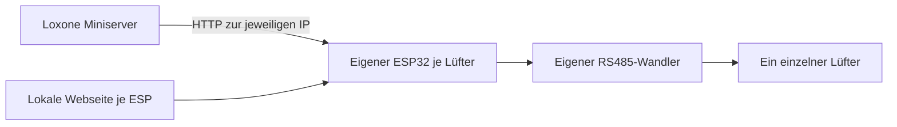

# Loxone: Lüfter einzeln einrichten

## Wo findet die Steuerung statt?

Die Oberfläche ist **Einrichtung und dauerhafte Bedienung** zugleich. Nach der
Einrichtung im Heimnetz die feste ESP-IP im Browser öffnen. Es ist kein
zusätzlicher Webserver, Cloudkonto oder laufender PC erforderlich. Das
Einrichtungs-WLAN wird geschlossen; die Webseite ist anschließend über das
Heim-WLAN erreichbar. Ein Lesezeichen am Handy reicht für die manuelle Bedienung.

Loxone und Webseite senden an dieselbe Steuerung. Der zuletzt angenommene
abweichende Befehl gilt; eine zusätzliche Prioritäts-/Sperrlogik ist nicht eingebaut.
Ein Loxone-Befehl kann also die manuelle Wahl später wieder überschreiben.
Die 500-ms-Telegramme, Motorpausen und WRG-Wechsel erzeugt der ESP selbst.
Browser und Loxone müssen dafür nicht ständig Befehle senden.

## Schritt für Schritt in Loxone Config

Voraussetzung: Lüfter ist manuell getestet, Bus freigegeben und ESP im selben
erreichbaren lokalen Netz wie der Miniserver. Keine RS485 Extension und kein
MQTT-Broker erforderlich. Bezeichnungen der Loxone-Config-Menüs können je Version
abweichen. Referenz: https://www.loxone.com/dede/kb/virtuelle-ausgaenge/

1. Dem ESP im Router eine feste DHCP-Zuordnung geben, z. B. `192.168.1.80`.
2. Auf der ESP-Webseite unter **4 · Mit Loxone verbinden** einen Befehl wählen.
   Die vollständige Adresse enthält deine IP und deinen individuellen API-Schlüssel.
3. In Loxone Config unter **Virtuelle Ausgänge** einen virtuellen Ausgang
   **pro Lüfter** anlegen, z. B. „Lüfter 1“. Als Adresse `http://192.168.1.80` eintragen.
4. Darunter einen **virtuellen Ausgangsbefehl** für „WRG Stufe 1“ anlegen.
   Unter **Befehl bei EIN** den relativen Pfad aus der folgenden Tabelle
   eintragen. HTTP GET verwenden. `KEY` durch den Schlüssel der ESP-Webseite ersetzen.
5. Für Boost, Aus und gegebenenfalls Tag/Nacht weitere Ausgangsbefehle anlegen.
   Bei getrennten Tasterbefehlen **Befehl bei AUS leer lassen**, damit das Loslassen
   des Tasters nicht gleich die nächste Betriebsart auslöst. Falls die verwendete
   Config-Version einen Impuls-/Tastermodus anbietet, diesen entsprechend nutzen.
6. Die Befehle mit Tastern bzw. deiner Betriebsartenlogik verbinden. Eine einzelne
   zentrale Betriebsartenwahl vermeidet widersprüchliche parallele Automationen.
7. Schritte für jeden weiteren Lüfter mit eigener ESP-IP und eigenem API-Schlüssel
   wiederholen. Die RS485-Leitungen der Lüfter bleiben voneinander getrennt.
8. Projekt in den Miniserver übertragen. WRG-Taster auslösen und auf der
   ESP-Webseite prüfen, ob die Betriebsart übernommen wurde. Tatsächliche
   Lüfterfunktion zusätzlich beobachten. Danach Aus und Boost prüfen.

Beispielpfade; die Ausgangsadresse und der relative Pfad bilden zusammen die URL:

| Funktion | Befehl bei EIN |
|---|---|
| WRG Stufe 1 | `/api/control?key=KEY&mode=wrg&level=1` |
| WRG Stufe 2 | `/api/control?key=KEY&mode=wrg&level=2` |
| Automatik Tag | `/api/control?key=KEY&mode=auto&humidity=2&night=0` |
| Automatik Nacht | `/api/control?key=KEY&mode=auto&humidity=2&night=1` |
| Boost 20 Minuten | `/api/control?key=KEY&mode=boost` |
| Aus | `/api/control?key=KEY&mode=off` |

Optional: Bei einem einfachen EIN/AUS-Schalter WRG unter „Befehl bei EIN“ und
Aus unter „Befehl bei AUS“ eintragen. Das unterscheidet sich bewusst von separaten
Betriebsart-Tastern, bei denen AUS leer bleibt.

Für Boost **keine zyklischen Wiederholungen** konfigurieren. Ein identischer
Befehl während des laufenden Boosts verlängert ihn nicht. Ein neuer Befehl nach
Ablauf startet jedoch erneut. Ohne neue Loxone-Anweisung stellt der ESP nach
20 Minuten die vorherige Betriebsart und Einstellungen wieder her.

Nach ESP-Neustart bleibt die Lüftung auf Aus. Ein dauerhaft hoher Loxone-Ausgang
sendet gegebenenfalls keine neue Schaltflanke. Für Wiederanlauf daher erneut
gezielt eine Betriebsart auslösen; eine automatische Wiederanlauf-/Überwachungslogik
ist in diesem Prototyp nicht enthalten.

## Rückmeldungen: was tatsächlich verfügbar ist

`GET http://ESP-IP/api/status` liefert JSON. Die ESP-Webseite liest diese Daten
bereits automatisch. Eine fertige Loxone-Vorlage zur Rückmeldung ist noch nicht
enthalten; dafür wären separate virtuelle HTTP-Eingänge und passende
Befehlserkennungen in Loxone Config anzulegen und zu testen.

- `mode`, `phase`: vom ESP angeforderter Zustand, kein Drehzahlnachweis.
- `device_status_received`: seit Start mindestens eine gültige Antwort empfangen.
- `status_age_ms`: Alter der letzten gültigen Antwort; alte Werte sind keine
  aktuelle Kommunikationsbestätigung.
- `dark`, `filter_1`, `filter_2`, `humidity_alarm`: zuletzt abgefragte Geräteflags;
  -1 bedeutet unbekannt, 0 inaktiv, 1 aktiv.

Die Sensorabfrage wird über die Webseite oder `POST /api/query?key=KEY` ausgelöst.
Sie erzwingt drei Sekunden Sendepause. Es gibt **keine automatische Sensorabfrage**;
JSON regelmäßig zu lesen aktualisiert die Lüftersensorwerte nicht.
HTTP 200 bei Steuerbefehlen bestätigt nur die Annahme durch den ESP.

## Mehrere unabhängige Lüfter

Je Lüfter werden ein ESP32-C3 und ein RS485-Wandler benötigt. Jeder ESP wird
separat eingerichtet und erhält eine feste IP-Zuordnung. Die Firmware ist identisch;
API-Schlüssel und Geräteeinstellungen werden auf jedem ESP separat gespeichert.

| Virtueller Ausgang | Adresse | Schlüssel |
|---|---|---|
| Lüfter 1 | `http://192.168.1.80` | Schlüssel von ESP 1 |
| Lüfter 2 | `http://192.168.1.81` | Schlüssel von ESP 2 |
| Weitere Lüfter | Jeweils eigene ESP-IP | Jeweils eigener Schlüssel |

Jeder einzelne Lüfter ist auf „Master mit Wandpanel“ eingestellt, um die externen
Telegramme zu empfangen. Es gibt keine angeschlossenen Slave-Lüfter und keine
gemeinsame RS485-Gruppe. Der ESP führt den Zyklus seines Lüfters eigenständig aus.
Synchronisierte oder gegenläufige Wechselzyklen zwischen mehreren ESPs sind
nicht implementiert. Gemeinsame Bedienung kann Loxone durch Senden von Befehlen
an mehrere virtuelle Ausgänge abbilden; dies synchronisiert die Zyklusphasen nicht.
