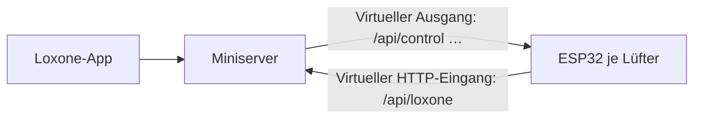
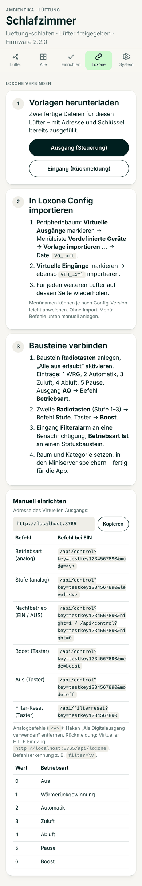
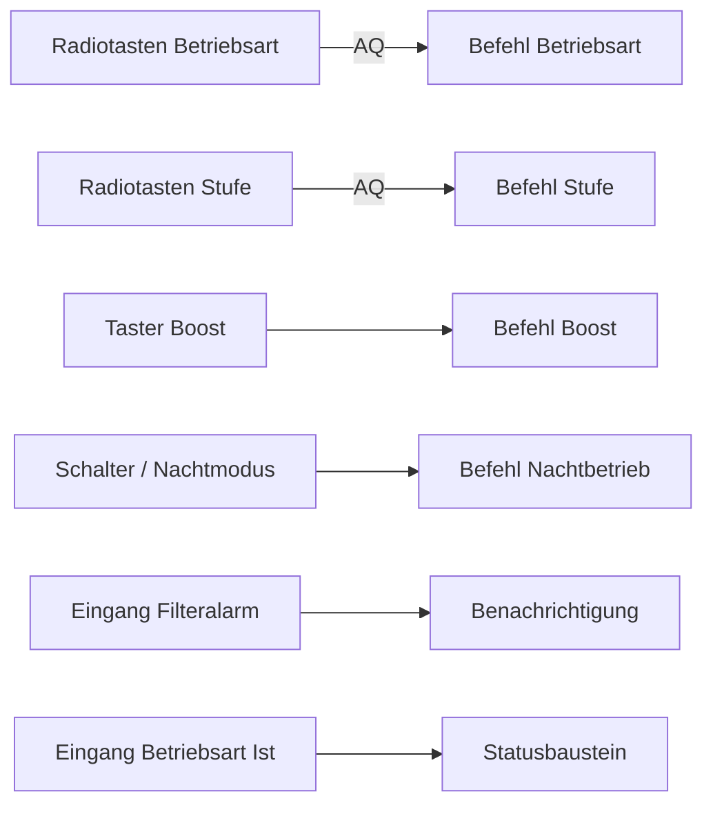
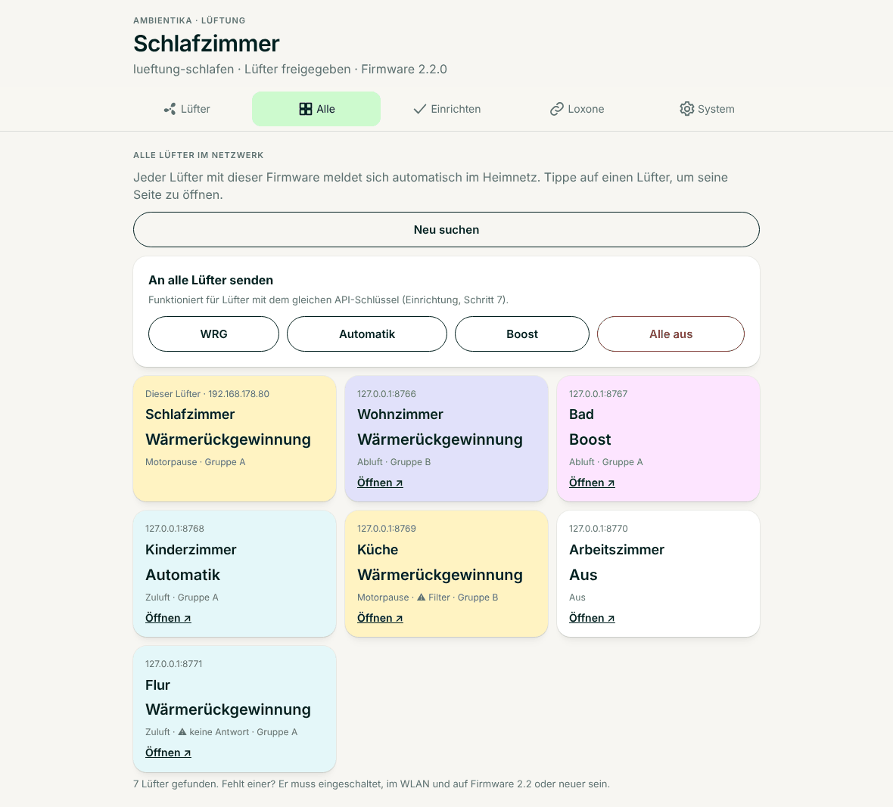

# Loxone-Integration (Firmware v2)

Diese Anleitung bindet einen oder bis zu 10 und mehr Lüfter in Loxone Config und die
Loxone-App ein.

1. [Prinzip](#1-prinzip)
2. [Voraussetzungen](#2-voraussetzungen)
3. [Weg A: Vorlagen importieren (empfohlen)](#3-weg-a-vorlagen-importieren)
4. [Weg B: manuell anlegen](#4-weg-b-manuell-anlegen)
5. [Bausteine für einen Lüfter](#5-bausteine-für-einen-lüfter)
6. [Alle Lüfter gemeinsam](#6-alle-lüfter-gemeinsam)
7. [Rückmeldungen](#7-rückmeldungen)
8. [Darstellung in der Loxone-App](#8-darstellung-in-der-loxone-app)
9. [Testen und Fehlersuche](#9-testen-und-fehlersuche)

> Menübezeichnungen können je nach Loxone-Config-Version leicht abweichen. Virtuelle Ein-
> und Ausgänge funktionieren nur, wenn das Programm **im Miniserver** läuft, nicht in der
> Simulation.

Die Anleitung für v1 findest du in [v1/LOXONE-v1.md](v1/LOXONE-v1.md). Die einfachen
Befehle (`mode=wrg` usw.) funktionieren in beiden Versionen.

---

## 1. Prinzip



- Die Loxone-App spricht **nur mit dem Miniserver**. Der Miniserver schickt HTTP-Befehle an
  die ESPs und fragt deren Zustand ab. Fernzugriff läuft wie gewohnt über Loxone; die ESPs
  brauchen **keine** Portfreigabe.
- Pro Lüfter legst du **einen Virtuellen Ausgang** (Steuerung) und **einen Virtuellen
  HTTP-Eingang** (Rückmeldung) an.
- Motorpausen, 500-ms-Takt, Richtungswechsel, Gegenlauf und das Boost-Ende erledigt der
  ESP selbst. Loxone sendet nur, **was** passieren soll.

## 2. Voraussetzungen

Für jeden Lüfter, siehe [ANLEITUNG.md](ANLEITUNG.md):
- feste IP-Adresse vergeben (Schritt 5.5)
- Lüfter freigegeben und einmal von Hand getestet
- am besten für alle Lüfter **derselbe API-Schlüssel** (Vorlage, Schritt 5.8)

---

## 3. Weg A: Vorlagen importieren

Jeder ESP erzeugt zwei fertige Vorlagen, in die **Adresse, Name und Schlüssel bereits
eingetragen** sind.

1. Die Seite des Lüfters öffnen → Tab **Loxone**.
2. **Ausgang (Steuerung)** → speichert `VO_Ambientika_<raum>.xml`.
3. **Eingang (Rückmeldung)** → speichert `VIH_Ambientika_<raum>.xml`.
4. In Loxone Config im Peripheriebaum **Virtuelle Ausgänge** markieren → in der Menüleiste
   **Vordefinierte Geräte → Vorlage importieren …** → die `VO_…xml` wählen.
5. **Virtuelle Eingänge** markieren → genauso die `VIH_…xml` importieren.
6. Für jeden weiteren Lüfter wiederholen. Bei 10 Lüftern kommst du so auf 10 Ausgänge und
   10 Eingänge, jeweils mit Raumnamen.



**Inhalt des Ausgangs** (Adresse `http://<IP des Lüfters>`):

| Befehl | Art | sendet |
|---|---|---|
| Betriebsart (0-6) | analog | `/api/control?key=…&mode=<v>` |
| Stufe (0-3) | analog | `/api/control?key=…&level=<v>` |
| Nachtbetrieb | digital (EIN/AUS) | `night=1` / `night=0` |
| Feuchtestufe 3 | digital (EIN/AUS) | `humidity=3` / `humidity=2` |
| Boost | digital (Taster) | `mode=boost` |
| Filter-Reset | digital (Taster) | `/api/filterreset?key=…` |

**Inhalt des Eingangs** (URL `http://<IP>/api/loxone`, Abfrage alle 30 s): Betriebsart
Ist, Stufe Ist, Richtung, Boost Restzeit, Filteralarm, Feuchtealarm, Dämmerung, Lüfter
antwortet, Bus freigegeben, WLAN-Empfang, Laufzeit.

> Bietet deine Config-Version kein „Vorlage importieren“ für virtuelle Geräte an, nimmst du
> Weg B. Die Seite zeigt im Tab **Loxone** alle Befehle zum Kopieren.

---

## 4. Weg B: manuell anlegen

**Virtueller Ausgang:** Peripheriebaum → *Virtuelle Ausgänge* → Menüleiste **Virtueller
Ausgang**.
- **Bezeichnung:** z. B. `Lüftung Schlafzimmer`
- **Adresse:** `http://192.168.178.80` (ohne Pfad)
- „Verbindung nach Senden schließen“ aktivieren, falls vorhanden

Darunter je Befehl einen **Virtuellen Ausgangsbefehl** anlegen. `KEY` ist der
API-Schlüssel (Seite des Lüfters → System bzw. Loxone).

| Bezeichnung | Befehl bei EIN | Befehl bei AUS | Als Digitalausgang verwenden |
|---|---|---|---|
| Betriebsart | `/api/control?key=KEY&mode=<v>` | – | **aus** (analog) |
| Stufe | `/api/control?key=KEY&level=<v>` | – | **aus** (analog) |
| Nachtbetrieb | `/api/control?key=KEY&night=1` | `/api/control?key=KEY&night=0` | an |
| Boost | `/api/control?key=KEY&mode=boost` | – (leer!) | an |
| Filter-Reset | `/api/filterreset?key=KEY` | – (leer!) | an |

HTTP-Methode jeweils `GET`. Bei Tastern **„Befehl bei AUS“ leer lassen**, sonst löst das
Loslassen gleich den nächsten Befehl aus.

**Virtueller HTTP-Eingang:** *Virtuelle Eingänge* → **Virtueller HTTP Eingang**.
- **URL:** `http://192.168.178.80/api/loxone`
- **Abfragezyklus:** `30` s

Darunter je Wert einen **Virtuellen HTTP Eingang Befehl** mit der passenden
Befehlserkennung, z. B. `mode=\v`, `filter=\v`, `comm_ok=\v` (alle Werte stehen in
[Abschnitt 7](#7-rückmeldungen)).

**Betriebsarten als Zahl** (für `mode=<v>`):

| Wert | 0 | 1 | 2 | 3 | 4 | 5 | 6 |
|---|---|---|---|---|---|---|---|
| Betriebsart | Aus | WRG | Automatik | Zuluft | Abluft | Pause | Boost |

---

## 5. Bausteine für einen Lüfter

Diese Verschaltung macht jeden Lüfter in der App bedienbar.



**a) Radiotasten „Betriebsart“**
- „Alle aus erlaubt“ **aktivieren**. Wert 0 bedeutet dann **Aus**.
- Einträge: 1 `Wärmerückgewinnung`, 2 `Automatik`, 3 `Zuluft`, 4 `Abluft`, 5 `Pause`
- Ausgang **AQ** → Befehl **Betriebsart**
- Boost bitte **nicht** als Radiotaste anlegen, sondern als eigenen Taster (d). Der ESP
  beendet den Boost nach 20 Minuten selbst und kehrt zur vorherigen Betriebsart zurück.
  Die Radiotasten bleiben so stimmig.

**b) Radiotasten „Stufe“:** Einträge `Stufe 1`, `Stufe 2`, `Stufe 3`, „Alle aus erlaubt“
**deaktiviert**. AQ → Befehl **Stufe**. Eine reine Stufenänderung übernimmt der ESP ohne
Motorpause.

**c) Nachtbetrieb** (nur für Automatik): ein Schalter in der App oder die Nachtzeit von
Loxone → Befehl **Nachtbetrieb**.

**d) Boost:** Baustein **Taster** (für die App) und/oder ein Wandtaster im Bad → Befehl
**Boost**. Drückst du erneut, während der Boost läuft, verlängert sich nichts.

**e) Filter-Reset** (optional): Taster → Befehl **Filter-Reset**. Nur nach Reinigung oder
Tausch des Filters betätigen.

**Nach Stromausfall** fährt der ESP die zuletzt gewählte Betriebsart selbst wieder an.
Loxone muss dafür nichts neu senden.

---

## 6. Alle Lüfter gemeinsam

Bei 8–10 Lüftern willst du meist **zentral** schalten und nur gelegentlich einzelne Räume
anders. So geht's:

**Zentrale Betriebsart:**
1. Eine Radiotasten-Instanz **„Lüftung alle“** anlegen (Einträge wie in 5a).
2. Ihren Ausgang **AQ** mit dem Befehl **Betriebsart** **aller** Lüfter verbinden.
   In Loxone Config darf ein Ausgang auf mehrere Eingänge gehen.
3. Wer einzelne Räume übersteuern können will, legt zusätzlich die Radiotasten pro Raum
   an. Es gilt dann der jeweils zuletzt gesendete Wert.

**Zentrale Stufe** und **Nachtbetrieb** genauso: einen Baustein an die Befehle aller
Lüfter verbinden. Typisch ist, den **Nachtbetrieb** an die Loxone-Nachtzeit zu koppeln
und die **Stufe** nachts auf 1 zu setzen.

**Boost** bleibt meist pro Raum (Bad, Küche).

**Gegenlauf:** Gruppe A/B stellst du auf den ESPs ein ([ANLEITUNG.md](ANLEITUNG.md#57-schritt-6-gegenläufigen-betrieb)).
Loxone muss nichts synchronisieren. Schaltest du alle gleichzeitig auf WRG, laufen die
Gruppen trotzdem gegenläufig.

**Ohne Loxone:** Auf jeder Lüfterseite gibt es den Tab **Alle**, mit „An alle Lüfter
senden“ (WRG, Automatik, Boost, Aus). Das setzt den gleichen API-Schlüssel auf allen
ESPs voraus.



---

## 7. Rückmeldungen

`http://<IP>/api/loxone` liefert eine Textseite (ohne Schlüssel, nur lesend):

```
mode=1
level=2
direction=1
phase_remaining=38
boost_remaining=0
filter=0
humidity_alarm=0
dark=0
comm_ok=1
sync_group=1
rssi=-58
…
```

| Wert | Bedeutung |
|---|---|
| `mode` | Betriebsart 0–6 (wie die Radiotasten, 6 = Boost) |
| `level` | Stufe 0–3 |
| `direction` | 0 steht/Pause, 1 Zuluft, 2 Abluft |
| `phase_remaining` | Sekunden bis zum nächsten Richtungswechsel |
| `boost_remaining` | Restzeit des Boosts in Sekunden |
| `filter` | Filterwechsel fällig: 1 ja, 0 nein, −1 noch unbekannt |
| `humidity_alarm` | Feuchtealarm 1/0/−1 |
| `dark` | Dämmerungssensor 1/0/−1 |
| `comm_ok` | 1 = Lüfter antwortet, 0 = keine Antwort (Verdrahtung!), −1 = noch nicht abgefragt |
| `status_age` | Sekunden seit der letzten Lüfterantwort |
| `sync_group` | 0 eigener Takt, 1 Gruppe A, 2 Gruppe B |
| `enabled` | 1 = Busausgabe freigegeben |
| `rssi` | WLAN-Empfang in dBm (besser als −75 anstreben) |
| `uptime` | Sekunden seit dem Start des ESP |

Den Sensorstatus liest der ESP alle 5 Minuten vom Lüfter. Häufigeres Abfragen von
`/api/loxone` belastet den Lüfter nicht.

**Typische Verwendung:**
- **Filterwechsel melden:** Eingang *Filteralarm* → Benachrichtigungs- bzw.
  Meldungsbaustein („Lüftung Bad: Filter reinigen“).
- **Störung melden:** *Lüfter antwortet* = 0 → Meldung „Lüftung Bad: keine Antwort“.
  Fällt der ganze ESP aus, meldet Loxone den nicht erreichbaren HTTP-Eingang (je nach
  Version im Systemstatus).
- **Tatsächliche Betriebsart anzeigen:** *Betriebsart Ist* → **Statusbaustein** mit Texten
  0 Aus, 1 WRG, 2 Automatik, 3 Zuluft, 4 Abluft, 5 Pause, 6 Boost. Dort siehst du auch
  das Boost-Ende oder eine Bedienung über die ESP-Seite.

---

## 8. Darstellung in der Loxone-App

1. Bei jedem Baustein, den du in der App sehen willst (Radiotasten, Taster, Schalter,
   Statusbaustein), in den Eigenschaften **Raum** und **Kategorie** setzen, z. B.
   Kategorie „Lüftung“.
2. Darauf achten, dass **„In Visualisierung verwenden“** aktiv ist; bei Hilfsbausteinen
   deaktivieren.
3. Sprechende Bezeichnungen vergeben („Lüftung Bad – Betriebsart“). Bei Radiotasten
   erscheinen die Texte der Einträge als Auswahl in der App.
4. Optional **Benutzerrechte** setzen.
5. Programm **in den Miniserver speichern**. Die App aktualisiert sich von selbst; falls
   nicht, einmal neu öffnen.

In der App findest du die Lüftung dann im jeweiligen Raum und gesammelt unter der
Kategorie „Lüftung“. Die zentrale „Lüftung alle“ markierst du am besten als **Favorit**.

---

## 9. Testen und Fehlersuche

**Nach dem Übertragen, für jeden Lüfter:**
1. In der App „Wärmerückgewinnung“ wählen. Auf der ESP-Seite erscheint „Motorpause“ und
   nach 10 s „Zuluft“ oder „Abluft“.
2. Die Stufe ändern: wird ohne Pause übernommen.
3. Boost: „noch 20 min“. Danach kehrt der Lüfter zur vorherigen Betriebsart zurück.
4. In Loxone zeigt *Lüfter antwortet* nach spätestens 5 Minuten den Wert 1.

**Befehl im Browser testen** (ersetzt Loxone zur Fehlersuche):
`http://192.168.178.80/api/control?key=KEY&mode=1`. Die Antwort ist ein JSON mit
`"mode":"wrg"`.

Auf der ESP-Seite unter **System → Protokoll** steht jeder angekommene Befehl mit der
IP des Absenders, also deines Miniservers, und jeder abgelehnte Befehl mit Grund.

| Problem | Ursache / Abhilfe |
|---|---|
| `401 API key required` | Schlüssel falsch, unvollständig kopiert oder auf dem ESP geändert |
| `409 Enable bus…` | Lüfter noch nicht freigegeben (Einrichtung, Schritt 5) |
| `400 …` | ungültiger Wert, z. B. `<v>` = 7. Bei Analogbefehlen „Als Digitalausgang verwenden“ abschalten |
| keine Reaktion, keine `Befehl von …`-Zeile im Protokoll | Adresse im Virtuellen Ausgang falsch, IP geändert (feste Zuordnung prüfen) oder Programm nur in der Simulation |
| Befehl kommt an, Lüfter reagiert nicht | DIP-Schalter, A/B vertauscht; `comm_ok=0` deutet auf die Verdrahtung |
| nach Neuflashen (Komplettimage) geht nichts mehr | neuer API-Schlüssel. Unter System den alten Schlüssel wieder eintragen oder die Vorlage laden |

Mehr in [FEHLERSUCHE.md](FEHLERSUCHE.md). Loxone-Referenz:
<https://www.loxone.com/dede/kb/virtuelle-ausgaenge/>
