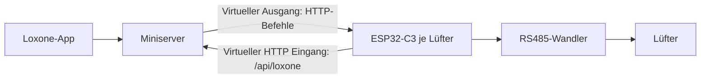

# Loxone-Integration Schritt für Schritt (Firmware v2)

Diese Anleitung führt vom eingerichteten ESP bis zur Bedienung in der Loxone-App:

1. [Feste IP-Adresse vergeben](#1-feste-ip-adresse-vergeben)
2. [Vorbereitung auf der ESP-Webseite](#2-vorbereitung-auf-der-esp-webseite)
3. [Steuerung in Loxone Config anlegen](#3-steuerung-in-loxone-config-anlegen)
4. [Rückmeldungen nach Loxone holen](#4-rückmeldungen-nach-loxone-holen)
5. [Darstellung in der Loxone-App](#5-darstellung-in-der-loxone-app)
6. [Mehrere Lüfter](#6-mehrere-lüfter)
7. [Testen und Fehlersuche](#7-testen-und-fehlersuche)

Für v1 gilt weiterhin die bisherige Fassung: [LOXONE-v1](v1/LOXONE-v1.md). Die Taster-Befehle aus
Abschnitt 3.3 funktionieren in beiden Versionen; Radiotasten (`mode=<v>`), Stufe ohne Betriebsart,
Filter-Reset und `/api/loxone` gibt es erst ab v2.



Die Loxone-App spricht **nur mit dem Miniserver**. Der Miniserver schickt HTTP-Befehle an
den ESP und fragt dessen Status ab. Die ESP-Webseite brauchst du nur für Einrichtung,
Updates und als Notbedienung.

---

## 1. Feste IP-Adresse vergeben

Loxone erreicht den ESP über seine IP-Adresse. Ändert sie sich (z. B. nach einem
Router-Neustart), kommen die Befehle nicht mehr an. Deshalb bekommt jeder ESP eine feste
Adresse. Es gibt zwei Wege – **Weg A ist empfohlen**.

### Vorher: Gerätenamen vergeben

Auf der ESP-Webseite unter **2 · Gerätename und feste IP-Adresse** einen sprechenden Namen
eintragen, z. B. `lueftung-schlafen`, `lueftung-bad`. Mit **DHCP** speichern; der ESP startet
neu. Unter diesem Namen erscheint er dann im Router, und er ist zusätzlich als
`http://lueftung-bad.local` erreichbar (mDNS – funktioniert auf PC/Handy, aber **nicht**
zuverlässig im Miniserver, daher in Loxone immer die IP eintragen).

### Weg A (empfohlen): Feste Zuordnung im Router (DHCP-Reservierung)

Der ESP bleibt auf „DHCP“, der Router gibt ihm aber immer dieselbe Adresse.

**FRITZ!Box** (FRITZ!OS 7.x/8.x):

1. `http://fritz.box` öffnen und anmelden.
2. **Heimnetz → Netzwerk → Netzwerkverbindungen** (bei älteren Versionen
   „Heimnetz → Heimnetzübersicht → Netzwerkverbindungen“).
3. Den ESP suchen – Name wie oben vergeben, z. B. `lueftung-bad`. Rechts auf den
   **Stift (Bearbeiten)** klicken.
4. Haken setzen bei **„Diesem Netzwerkgerät immer die gleiche IPv4-Adresse zuweisen“**.
   Wenn gewünscht, die IPv4-Adresse ändern (z. B. `192.168.178.80`).
5. **OK/Übernehmen**.
6. Auf der ESP-Webseite unter **6** auf **ESP neu starten** klicken, damit er die
   (ggf. neue) Adresse sofort bezieht. Danach im Browser `http://192.168.178.80` öffnen.

**Andere Router:** Der Menüpunkt heißt meist „DHCP-Reservierung“, „Statische DHCP-Zuweisung“,
„Adressreservierung“ oder „Fixed IP“ (UniFi: Client → Einstellungen → „Fixed IP Address“;
Telekom Speedport: Heimnetzwerk → Heimnetzwerk (LAN) → Übersicht der Geräte →
„Immer die gleiche IP-Adresse vergeben“). Die MAC-Adresse des ESP steht in der Geräteliste
des Routers neben dem Gerätenamen.

### Weg B: Statische IP direkt im ESP

Nur wenn der Router keine Reservierung kann.

1. Im Router nachsehen, welchen Bereich der DHCP-Server vergibt. FRITZ!Box: **Heimnetz →
   Netzwerk → Netzwerkeinstellungen → IPv4-Einstellungen** (ab Werk `.20` bis `.200`).
2. Eine freie Adresse **außerhalb** dieses Bereichs wählen, z. B. `192.168.178.210`.
3. Auf der ESP-Webseite unter **2**: „Statisch im ESP festlegen“, IP-Adresse,
   Subnetzmaske (meist `255.255.255.0`), Gateway (= Router, FRITZ!Box `192.168.178.1`)
   und optional DNS eintragen. **Speichern und neu starten**.
4. Den ESP unter der neuen Adresse öffnen.

Falsch eingetragen und der ESP ist nicht mehr erreichbar? **BOOT-Taster am ESP 10 Sekunden
gedrückt halten.** Danach sind WLAN, Gerätepasswort und Netzwerkeinstellungen gelöscht,
der ESP öffnet das Einrichtungs-WLAN (Passwort `Lueftung-Start`). API-Schlüssel und
Lüfterfreigabe bleiben erhalten, Loxone muss also nicht angepasst werden.

### Adressplan notieren

| Lüfter | Gerätename | IP-Adresse | API-Schlüssel |
|---|---|---|---|
| Schlafzimmer | `lueftung-schlafen` | `192.168.178.80` | (von ESP-Seite 5) |
| Bad | `lueftung-bad` | `192.168.178.81` | … |
| … | … | … | … |

Miniserver und ESPs müssen im selben Netz sein (bzw. der Miniserver muss die ESPs erreichen
können). Keine Portfreigabe ins Internet einrichten – Fernzugriff läuft über die
Loxone-App/den Miniserver.

---

## 2. Vorbereitung auf der ESP-Webseite

Für jeden Lüfter:

1. **Gerätepasswort** gesetzt (Abschnitt 1) – danach fragt der Browser beim Öffnen nach
   Benutzer `admin` und diesem Passwort.
2. **Lüfter freigegeben** (Abschnitt 3) und von Hand getestet (z. B. WRG Stufe 1).
3. Abschnitt 4: Haken bei **„Nach Stromausfall/Neustart letzte Betriebsart
   wiederherstellen“** (Standard: an) und **„Sensorstatus alle 5 Minuten automatisch
   abfragen“** (Standard: an).
4. Abschnitt 5 **Mit Loxone verbinden** offen lassen: Dort stehen für jeden Befehl die
   fertige **Adresse** und der fertige **„Befehl bei EIN“** inkl. API-Schlüssel zum Kopieren.

---

## 3. Steuerung in Loxone Config anlegen

> Menübezeichnungen können je nach Loxone-Config-Version leicht abweichen.
> Virtuelle Ausgänge und Eingänge funktionieren nur, wenn das Programm **im Miniserver**
> läuft – nicht in der Simulation von Loxone Config.

### 3.1 Virtuellen Ausgang je Lüfter anlegen

1. Im **Peripheriebaum** links **Virtuelle Ausgänge** markieren.
2. In der Menüleiste **Virtueller Ausgang** wählen.
3. Eigenschaften:
   - **Bezeichnung:** z. B. `Lüftung Bad`
   - **Adresse:** `http://192.168.178.81` (die feste IP aus Schritt 1, ohne Pfad)
   - „Verbindung nach Senden schließen“: aktivieren (falls vorhanden).

Unter diesem virtuellen Ausgang legst du nun die einzelnen **Virtuellen Ausgangsbefehle**
an (Ausgang markieren → Menüleiste **Virtueller Ausgangsbefehl**).

### 3.2 Empfohlener Aufbau: Radiotasten für die Betriebsart

So wird die Betriebsart in der App als Auswahlliste angezeigt und mit **einem** Befehl
übertragen.

**a) Ausgangsbefehl „Betriebsart“**

| Eigenschaft | Wert |
|---|---|
| Bezeichnung | `Betriebsart` |
| Befehl bei EIN | `/api/control?key=KEY&mode=<v>` |
| HTTP-Methode bei EIN | `GET` |
| Befehl bei AUS | leer |
| **Als Digitalausgang verwenden** | **Haken entfernen** (analog) |

`KEY` durch den API-Schlüssel ersetzen (oder den fertigen Befehl von der ESP-Seite kopieren,
Auswahl „Betriebsart per Radiotasten“). Loxone setzt für `<v>` den aktuellen Wert ein und
sendet bei jeder Wertänderung.

**b) Baustein „Radiotasten“** auf die Programmseite ziehen und konfigurieren:

| Radiotasten-Ausgang (Wert AQ) | Bezeichnung (Eigenschaften des Bausteins) | ESP-Betriebsart |
|---|---|---|
| 0 (alle aus) | `Aus` | Motor aus, Klappe zu |
| 1 | `Wärmerückgewinnung` | WRG (60 s Zu-/60 s Abluft) |
| 2 | `Automatik` | Automatik mit Feuchtesensor |
| 3 | `Zuluft` | Dauerhafte Zuluft |
| 4 | `Abluft` | Dauerhafte Abluft |
| 5 | `Pause` | Motor Pause, Klappe offen |

- In den Eigenschaften **„Alle aus erlaubt“** aktivieren, damit Wert 0 (= Aus) wählbar ist.
- Den **Analogausgang AQ** der Radiotasten mit dem Ausgangsbefehl **Betriebsart** verbinden.
- Raum und Kategorie setzen (siehe Abschnitt 5), damit er in der App erscheint.

Boost bitte **nicht** als 6. Radiotaste anlegen (das ginge technisch mit Wert 6), sondern als
eigenen Taster (unten). Grund: Der ESP beendet Boost nach 20 Minuten selbst und kehrt zur
vorherigen Betriebsart zurück – die Radiotasten zeigen dann weiterhin die richtige Auswahl.

**c) Ausgangsbefehl „Stufe“** (für WRG, Zuluft, Abluft)

| Eigenschaft | Wert |
|---|---|
| Bezeichnung | `Stufe` |
| Befehl bei EIN | `/api/control?key=KEY&level=<v>` |
| Als Digitalausgang verwenden | Haken entfernen |

Dazu einen zweiten Baustein **Radiotasten** mit drei Einträgen (`Stufe 1`, `Stufe 2`,
`Stufe 3`), „Alle aus erlaubt“ **deaktiviert**, AQ an den Befehl **Stufe**. Alternativ
geht auch ein Baustein mit einem Analogwert 0–3 (z. B. „Schieberegler“/„Analogwert-
Speicher“ mit Min 1, Max 3, Schritt 1). Eine reine Stufenänderung übernimmt der ESP ohne
Motorpause und ohne den WRG-Zyklus neu zu starten.

**d) Ausgangsbefehl „Nachtbetrieb“** (nur Automatik)

| Eigenschaft | Wert |
|---|---|
| Befehl bei EIN | `/api/control?key=KEY&night=1` |
| Befehl bei AUS | `/api/control?key=KEY&night=0` |
| Als Digitalausgang verwenden | Haken gesetzt |

Eingang z. B. mit einem Schalter in der App, mit dem Loxone-Nachtmodus oder einem
Dämmerungssignal verbinden. Feuchtestufe analog mit `humidity=2` / `humidity=3`.

**e) Ausgangsbefehl „Boost“**

| Eigenschaft | Wert |
|---|---|
| Befehl bei EIN | `/api/control?key=KEY&mode=boost` |
| Befehl bei AUS | **leer** |
| Als Digitalausgang verwenden | Haken gesetzt |

Mit einem **Taster** verbinden (z. B. Baustein „Taster“ für die App, ein Wandtaster im Bad
oder ein Feuchte-Schwellwert). Ein erneuter Druck während des Boosts verlängert ihn nicht.
Nach 20 Minuten kehrt der ESP automatisch zur vorherigen Betriebsart zurück – auch zu
„Aus“, wenn die Lüftung vorher aus war. Boost vorzeitig beenden: in den Radiotasten eine
Betriebsart wählen (bzw. erneut die gleiche Taste antippen).

**f) Ausgangsbefehl „Filter-Reset“** (optional)

| Eigenschaft | Wert |
|---|---|
| Befehl bei EIN | `/api/filterreset?key=KEY` |
| Befehl bei AUS | leer |
| Als Digitalausgang verwenden | Haken gesetzt |

Mit einem Taster verbinden und nur nach Filterwechsel/-reinigung betätigen. Der Motor steht
dafür 2 Sekunden, danach läuft die vorherige Betriebsart weiter (wieder mit Motorpause).

### 3.3 Alternative: einfache Taster je Betriebsart

Statt Radiotasten kannst du für jede Betriebsart einen digitalen Ausgangsbefehl anlegen
(„Als Digitalausgang verwenden“ an, **„Befehl bei AUS“ leer**, damit das Loslassen nichts
auslöst):

| Funktion | Befehl bei EIN |
|---|---|
| WRG Stufe 1 | `/api/control?key=KEY&mode=wrg&level=1` |
| WRG Stufe 2 | `/api/control?key=KEY&mode=wrg&level=2` |
| Automatik Tag | `/api/control?key=KEY&mode=auto&humidity=2&night=0` |
| Automatik Nacht | `/api/control?key=KEY&mode=auto&humidity=2&night=1` |
| Boost 20 Minuten | `/api/control?key=KEY&mode=boost` |
| Aus | `/api/control?key=KEY&mode=off` |

Für einen einfachen EIN/AUS-Schalter: „Befehl bei EIN“ = WRG, „Befehl bei AUS“ = Aus.

Statt `mode=wrg` usw. sind überall auch die Zahlen erlaubt: `0` Aus, `1` WRG, `2` Automatik,
`3` Zuluft, `4` Abluft, `5` Pause, `6` Boost.

### 3.4 Nach Stromausfall

Mit v2 merkt sich der ESP die letzte Betriebsart (nie Boost) und fährt sie nach einem
Stromausfall automatisch wieder an – mit 10 s Motorpause; die Klappe braucht laut
Geräteanleitung zusätzlich 40–60 s. Loxone muss dafür nichts erneut senden. Wer das nicht
möchte, nimmt den Haken auf der ESP-Seite (Abschnitt 4) heraus; dann startet der ESP in „Aus“.

---

## 4. Rückmeldungen nach Loxone holen

Der ESP stellt unter `http://ESP-IP/api/loxone` eine einfache Textseite bereit (ohne
Schlüssel, nur lesend):

```
mode=1
level=2
humidity_level=2
night=0
enabled=1
direction=1
boost_remaining=0
dark=0
filter=0
humidity_alarm=0
comm_ok=1
status_age=42
rssi=-61
uptime=86400
```

| Wert | Bedeutung |
|---|---|
| `mode` | Betriebsart 0–6 (gleiche Zahlen wie die Radiotasten, 6 = Boost) |
| `level` | Stufe 0–3 |
| `night`, `humidity_level` | Automatik-Einstellungen |
| `enabled` | 1 = Busausgabe freigegeben |
| `direction` | 0 steht/Pause, 1 Zuluft, 2 Abluft (gesendeter Befehl, keine gemessene Drehzahl) |
| `boost_remaining` | Restzeit Boost in Sekunden |
| `filter` | Filterwechselalarm: 1 aktiv, 0 inaktiv, −1 unbekannt |
| `humidity_alarm` | Feuchtealarm: 1/0/−1 |
| `dark` | Dämmerungssensor: 1/0/−1 |
| `comm_ok` | 1 = Lüfter hat auf die letzte Statusabfrage geantwortet, 0 = keine Antwort (Verdrahtung prüfen), −1 = noch nicht abgefragt |
| `status_age` | Alter der letzten Lüfterantwort in Sekunden (−1 = noch keine) |
| `rssi` | WLAN-Empfang in dBm (besser als −75 anstreben) |
| `uptime` | Sekunden seit ESP-Start |

Die Sensorwerte holt der ESP automatisch alle 5 Minuten vom Lüfter (jeweils 3 s Sendepause
laut Hersteller). Häufigeres Abrufen von `/api/loxone` belastet den Lüfter nicht.

### 4.1 Virtuellen HTTP-Eingang anlegen

1. Im Peripheriebaum **Virtuelle Eingänge** markieren → Menüleiste **Virtueller HTTP Eingang**.
2. Eigenschaften:
   - **Bezeichnung:** `Lüftung Bad Status`
   - **URL:** `http://192.168.178.81/api/loxone`
   - **Abfragezyklus [s]:** `30` (10–60 s sind sinnvoll)
3. Darunter je Wert einen **Virtuellen HTTP Eingang Befehl** anlegen
   (HTTP-Eingang markieren → Menüleiste **Virtueller HTTP Eingang Befehl**):

| Bezeichnung | Befehlserkennung |
|---|---|
| Betriebsart Ist | `mode=\v` |
| Stufe Ist | `level=\v` |
| Richtung | `direction=\v` |
| Boost Restzeit | `boost_remaining=\v` |
| Filteralarm | `filter=\v` |
| Feuchtealarm | `humidity_alarm=\v` |
| Lüfter antwortet | `comm_ok=\v` |
| WLAN-Empfang | `rssi=\v` |

`\v` liest die Zahl hinter dem Text. Für Alarme eignen sich als Einheit/Anzeige z. B.
„Digital“ bzw. eine Wertanzeige.

### 4.2 Typische Verwendung

- **Filterwechsel melden:** `Filteralarm` (Wert 1) an einen Benachrichtigungs-/Meldungs-
  baustein (z. B. „Push-Benachrichtigung“ bzw. Statusbaustein mit Meldung, je nach
  Config-Version) oder an die Systemstatus-Meldungen anschließen.
- **Störung melden:** `Lüfter antwortet` = 0 → Hinweis „Lüftung Bad: keine Antwort, Verdrahtung
  prüfen“. Fällt zusätzlich der ganze HTTP-Eingang aus (ESP offline), meldet Loxone das je nach
  Version im Systemstatus; alternativ `uptime` überwachen.
- **Anzeige der tatsächlichen Betriebsart:** `Betriebsart Ist` in einen **Statusbaustein**
  führen und dort Texte zuordnen (0 Aus, 1 WRG, 2 Automatik, 3 Zuluft, 4 Abluft, 5 Pause,
  6 Boost). Das zeigt auch Änderungen, die nicht aus Loxone kamen (z. B. Boost-Ende oder
  Bedienung über die ESP-Webseite).
- **Boost per Feuchte:** Ein Luftfeuchtesensor im Bad kann über einen Schwellwertschalter den
  Boost-Befehl auslösen; `Feuchtealarm` vom Lüfter selbst geht ebenfalls.

---

## 5. Darstellung in der Loxone-App

Was in der App erscheint, legst du in Loxone Config fest:

1. Bei jedem Baustein, der in der App bedienbar sein soll (Radiotasten „Betriebsart“,
   Radiotasten „Stufe“, Taster „Boost“, Schalter „Nachtbetrieb“, Statusbaustein, Filteralarm),
   in den Eigenschaften **Raum** (z. B. „Bad“) und **Kategorie** (z. B. „Lüftung“ – ggf. unter
   „Kategorien“ neu anlegen) zuweisen.
2. Darauf achten, dass **„In Visualisierung verwenden“** (bzw. „Visualisierung“) aktiv ist.
   Hilfsbausteine, die nicht in die App sollen, dort deaktivieren.
3. Sinnvolle **Bezeichnungen** vergeben, z. B. „Lüftung Bad – Betriebsart“. Bei Radiotasten
   die Texte der einzelnen Ausgänge setzen (Aus, Wärmerückgewinnung, …) – genau diese Texte
   zeigt die App als Auswahl.
4. Optional **Benutzerrechte** setzen, wer die Lüftung bedienen darf.
5. Programm in den Miniserver **speichern** (Übertragen). Die App aktualisiert sich danach
   automatisch (ggf. App einmal neu öffnen).

In der App findest du die Lüftung dann unter dem Raum bzw. der Kategorie „Lüftung“. Für die
Startseite der App kann man die Betriebsart als **Favorit** markieren (in der App lange auf
das Element tippen bzw. über das Stern-/Favoriten-Symbol).

Für die Bedienung von unterwegs ist nichts weiter nötig: Die App verbindet sich wie gewohnt
über den Loxone-Fernzugriff mit dem Miniserver, der Miniserver spricht lokal mit den ESPs.

Hinweis zur Synchronität: Die Radiotasten zeigen, was Loxone zuletzt **gesendet** hat. Wird
die Lüftung zusätzlich über die ESP-Webseite bedient, kann die Auswahl in der App davon
abweichen – die tatsächliche Betriebsart siehst du im Statusbaustein (Abschnitt 4.2). Im
Alltag am besten nur über Loxone bedienen.

---

## 6. Mehrere Lüfter

Jeder Lüfter hat seinen eigenen ESP, eigene IP und eigenen API-Schlüssel. In Loxone Config
legst du die Abschnitte 3 und 4 **je Lüfter einmal** an:

| Virtueller Ausgang | Adresse | Virtueller HTTP Eingang |
|---|---|---|
| Lüftung Schlafzimmer | `http://192.168.178.80` | `http://192.168.178.80/api/loxone` |
| Lüftung Bad | `http://192.168.178.81` | `http://192.168.178.81/api/loxone` |
| … | … | … |

Tipp: Ersten Lüfter komplett anlegen und testen, dann die virtuellen Ausgänge/Eingänge
kopieren (Kopieren/Einfügen im Peripheriebaum) und nur Adresse und Schlüssel ändern.

Für „alle Lüfter gleichzeitig“ den AQ einer zentralen Radiotasten-Auswahl mit den
Ausgangsbefehlen **mehrerer** virtueller Ausgänge verbinden. Die ESPs laufen ihre
WRG-Wechselzyklen unabhängig; eine synchronisierte oder gegenläufige Paarsteuerung über
mehrere ESPs ist nicht implementiert.

---

## 7. Testen und Fehlersuche

**Test nach dem Übertragen:**

1. In der App „Wärmerückgewinnung“ wählen → ESP-Webseite (Abschnitt 4) zeigt
   „Wärmerückgewinnung · Pause“, nach 10 s „Zuluft“. Am Lüfter beobachten.
2. Stufe ändern → wird ohne Pause übernommen.
3. Boost drücken → „Boost · noch 20 min“. Nach Ablauf zurück zur vorherigen Betriebsart.
4. „Aus“ → Klappe schließt.
5. Status in Loxone prüfen: `comm_ok` sollte nach spätestens 5 Minuten 1 sein.
6. Stromausfall simulieren (Sicherung kurz aus) → Lüftung läuft danach in der letzten
   Betriebsart wieder an.

**Protokoll ansehen:** ESP-Seite → **7 · Protokoll**. Dort steht jeder angekommene Befehl mit
der IP des Absenders (Miniserver) und jeder abgelehnte Befehl mit Grund – siehe
[FEHLERSUCHE.md](FEHLERSUCHE.md).

**Befehl im Browser testen** (ersetzt Loxone, gut zur Fehlersuche):
`http://192.168.178.81/api/control?key=KEY&mode=1` → Antwort ist ein JSON mit `"mode":"wrg"`.

| Problem | Ursache / Abhilfe |
|---|---|
| Antwort `401 API key required` | Schlüssel falsch oder unvollständig kopiert. |
| Antwort `409 Enable bus…` | Lüfter auf der ESP-Seite noch nicht freigegeben (Abschnitt 3). |
| Antwort `400 …` | Wert ungültig, z. B. `<v>` liefert 7. Bei Analogbefehlen „Als Digitalausgang verwenden“ deaktivieren. |
| Keine Reaktion, ESP-Seite nicht erreichbar | IP geändert → feste Zuordnung prüfen (Abschnitt 1). WLAN schwach (`rssi` < −80) → ESP näher am Router/Repeater oder auf der ESP-Seite „WLAN-Sendeleistung reduzieren“ testen. |
| Befehle kommen an, Lüfter reagiert nicht | DIP-Schalter „Master mit Wandpanel“, A/B vertauscht? `comm_ok=0` deutet auf Verdrahtung hin. |
| In der Simulation passiert nichts | Virtuelle Ein-/Ausgänge funktionieren nur im Miniserver, nicht in der Simulation. |
| Nach Neuflashen (Komplettimage) geht nichts mehr | Neuer API-Schlüssel. Auf der ESP-Seite unter 5 → „API-Schlüssel“ den alten Schlüssel wieder eintragen. Künftig das Update-Image (0xE000) oder die Weboberfläche verwenden, dann bleibt alles erhalten. |

Referenz zu virtuellen Ausgängen (Loxone Knowledge Base): https://www.loxone.com/dede/kb/virtuelle-ausgaenge/
