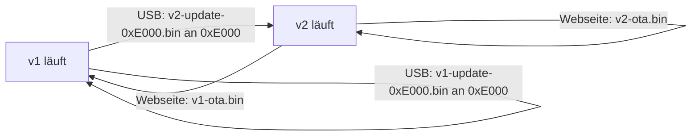

# Versionen und Wechsel zwischen v1 und v2

Beide Versionen liegen fertig im Repository und nutzen dieselbe Verdrahtung und dieselben
gespeicherten Grundeinstellungen (WLAN, API-Schlüssel, Busfreigabe). Du kannst jederzeit
wechseln.

| | v1 (getestet, bisher geflasht) | v2 (Firmware 2.2.2) |
|---|---|---|
| Dateien | [dist/v1](../dist/v1/) | [dist/v2](../dist/v2/) |
| Quellcode | Commit `b0c1332` | aktueller Stand |
| Loxone-Anleitung | [v1/LOXONE-v1.md](v1/LOXONE-v1.md) | [LOXONE.md](LOXONE.md) |

## Firmware 2.2.2 (Praxistest)

- **Statusantwort echter Geräte:** Ein Lüfter antwortete im Test mit `<02>000808<03>`
  statt im Format des Hersteller-PDFs (`00` + 8 Zeichen aus 0/1). Bisher meldete die
  Firmware deshalb fälschlich „Lüfter antwortet nicht“. Jetzt gilt jede Antwort mit
  Nachrichtentyp `00` und Hex-Inhalt als gültig. Das PDF-Format wird weiter ausgewertet.
  Andere Formate erscheinen als **Rohdaten** (Seite, Protokoll, `status_raw` in
  `/api/status`). Die Sensorwerte bleiben dann „unbekannt“, bis die Codierung geklärt ist.

## Firmware 2.2.1 (Fehlerbehebung)

- **Ersteinrichtung:** Nach dem Festlegen des Gerätepassworts und einer Namensänderung
  startete der ESP neu und öffnete das Einrichtungs-WLAN mit dem neuen Gerätepasswort statt
  `Lueftung-Start`. Das Handy konnte sich deshalb nicht mehr verbinden. Jetzt gilt das
  Gerätepasswort für das Einrichtungs-WLAN erst, wenn ein Heim-WLAN eingerichtet ist.
- Ein neuer Gerätename wird ohne Neustart übernommen, solange der ESP noch nicht mit dem
  Heim-WLAN verbunden ist.

## Neu in Firmware 2.2.0 (Mehrlüfter-Version)

**Für 8–10 Lüfter**
- **Gegenlauf-Gruppen A/B:** Lüfter einer Gruppe wechseln gleichzeitig die Richtung,
  Gruppe A und B laufen immer gegenläufig. Der Takt wird aus der Uhrzeit (NTP) gebildet,
  ohne Kabel zwischen den ESPs. Jeder Wechsel läuft weiterhin über ≥ 10 s Motorpause. Ohne
  Uhrzeit läuft jeder Lüfter im eigenen Takt weiter.
- **Übersicht „Alle Lüfter“:** Die ESPs finden sich per mDNS (`_ambientika._tcp`). Der
  Tab zeigt alle Lüfter mit Zustand; „An alle senden“ für WRG, Automatik, Boost und Aus.
- **Vorlage für weitere Lüfter:** WLAN, Gerätepasswort, Optionen und optional ein
  gemeinsamer API-Schlüssel werden mit einer Datei übertragen.
- **Loxone-Vorlagen zum Import:** Virtueller Ausgang und Virtueller HTTP-Eingang als
  XML-Datei, mit eingetragener Adresse und eingetragenem Schlüssel.
- **Anzeigename** pro Lüfter (mit Umlauten), getrennt vom Gerätenamen im Netzwerk.

**Einrichtung und Bedienung**
- **Neues Design** (angelehnt an das Lattice-Designsystem): Tabs Lüfter, Alle,
  Einrichten, Loxone, System. Betriebsart per Kachel mit einem Tipp, ohne
  „Übernehmen“-Knopf. Countdown bis zum nächsten Richtungswechsel. Dunkelmodus.
- **Einrichtungsassistent** mit 7 Schritten und Fortschrittsanzeige.
- **Captive Portal:** Nach dem Verbinden mit dem Einrichtungs-WLAN öffnet das Handy die
  Seite automatisch.

**Grundsätzliche Verbesserungen**
- **Watchdog:** Hängt die Firmware länger als 30 s, startet der ESP neu und läuft in der
  gespeicherten Betriebsart weiter.
- **Stabileres Einrichtungs-WLAN:** Solange es offen ist, sucht der ESP das Heim-WLAN nur
  noch minütlich. Das dauernde Suchen hat verbundene Handys immer wieder getrennt.
- Die Bedienseite wird statisch ausgeliefert, der Schlüssel kommt erst nach der Anmeldung
  (`/api/session`). Das spart Arbeitsspeicher.
- Lesende Schnittstellen erlauben Abrufe von anderen Lüfterseiten (CORS), damit die
  Übersicht funktioniert.
- WLAN-Zugangsdaten werden nicht mehr zusätzlich vom WLAN-Treiber in den Flash
  geschrieben.

## Was ist neu in v2 gegenüber v1?

**Sicherheit**
- **Gerätepasswort** pro ESP: schützt die Bedienseite (Benutzer `admin`), das
  Einrichtungs-WLAN und Updates. Vorher konnte jeder im Heimnetz den API-Schlüssel auf
  der Startseite ablesen.
- **Einrichtungs-WLAN** öffnet sich nicht mehr bei jedem Neustart, sondern nur ohne
  gespeichertes WLAN oder nach 2 Minuten WLAN-Ausfall. Mit gesetztem Gerätepasswort nutzt es
  dieses Passwort; das öffentlich bekannte `Lueftung-Start` gilt nur bis zur Einrichtung
  (dann höchstens 10 Minuten je Neustart).
- **BOOT-Taster 10 s halten** setzt WLAN, Passwort und Netzwerk zurück (API-Schlüssel und
  Freigabe bleiben).
- **API-Schlüssel kann gesetzt werden** – z. B. den alten Schlüssel nach einem Neuflashen,
  damit Loxone unverändert weiterläuft.

**Bedienung und Betrieb**
- **Firmware-Update über die Weboberfläche** (OTA), Einstellungen bleiben erhalten.
- **Filteralarm zurücksetzen** (Herstellerbefehl „Motor aus, Reset Filterwechsel“) per
  Webseite und Loxone.
- **Letzte Betriebsart nach Stromausfall wiederherstellen** (abschaltbar; Boost nie).
- **Boost aus „Aus“** kehrt nach 20 Minuten wieder zu „Aus“ zurück (v1: wechselte zu WRG).
- **Reine Stufenänderung** ohne 10-s-Motorpause und ohne Neustart des WRG-Zyklus.
- „Freigeben“ bei bereits freigegebenem Bus schaltet die Lüftung nicht mehr aus.

**Loxone und Rückmeldungen**
- **Automatische Sensorabfrage** alle 5 Minuten (abschaltbar), plus Kommunikationsstatus
  `comm_ok` (antwortet der Lüfter?).
- **`/api/loxone`**: Textformat für Loxone-Befehlserkennung (`filter=\v` usw.).
- **Betriebsart als Zahl 0–6** (`mode=<v>`) für Loxone-Radiotasten; Stufe/Nacht/Feuchte auch
  ohne Betriebsart setzbar (`level=<v>`).
- Weitere Statuswerte: Boost-Restzeit, Richtung, WLAN-Empfang, Laufzeit, Firmwareversion.

**Netzwerk**
- **Gerätename** (Hostname) – erscheint so im Router, plus `http://name.local` (mDNS).
- **Statische IP** optional direkt im ESP.
- Option **„WLAN-Sendeleistung reduzieren“** gegen die bekannten WLAN-Probleme des
  ESP32-C3 Super Mini.

**Fehlersuche (Firmware 2.1.0)**
- **Ereignisprotokoll** auf der ESP-Seite (Tab System) zum Anzeigen, Herunterladen und
  Kopieren: Starts mit Grund (Stromausfall/Absturz/Unterspannung), WLAN mit Trennungsgrund,
  Befehle mit Absender, abgelehnte Befehle, Lüfterantworten mit Rohdaten, Updates.
  Die letzten 200 Einträge überstehen Neustarts, wichtige Ereignisse auch Stromausfälle.
  Uhrzeit per NTP. Details: [FEHLERSUCHE.md](FEHLERSUCHE.md)

**Code**
- Firmware neu strukturiert (Betriebsarten als `enum`, benannte Zeitkonstanten,
  kommentierte Funktionen), Telegramme unverändert gegenüber v1 und gegen das
  Hersteller-PDF geprüft.
- Native Tests erweitert; Buildscript ohne feste Pfade.

## Wechselwege

### v1 → v2 (erstmalig)

v1 hat kein Web-Update, daher **einmal per USB**:

1. Auf der v1-Seite „Aus“ wählen.
2. ESP per USB anschließen und `dist/v2/ambientika-c3-v2-update-0xE000.bin` an **0xE000**
   flashen ([FLASHEN.md](FLASHEN.md)).
3. ESP startet mit v2, WLAN, API-Schlüssel und Freigabe sind noch da. Die Seite ist unter
   der bekannten IP erreichbar und **noch ohne Passwort** – als Erstes im Tab **Einrichten** das
   Gerätepasswort festlegen.
4. Im Tab **Einrichten** Namen, Gruppe und Vorlage erledigen, unter **System** die Optionen prüfen.
5. Loxone-Befehle aus v1 funktionieren unverändert weiter. Die neuen Möglichkeiten
   (Radiotasten, Rückmeldung) nach [LOXONE.md](LOXONE.md) ergänzen.

### v2 → v1 (zurück)

1. Auf der v2-Seite „Aus“ wählen.
2. Tab **System → Firmware-Update**: `dist/v1/ambientika-c3-v1-ota.bin` hochladen
   (der Hinweis zum Dateinamen kann bestätigt werden). Alternativ per USB
   `ambientika-c3-v1-update-0xE000.bin` an 0xE000.
3. v1 startet mit WLAN, API-Schlüssel und Freigabe. Zu beachten: v1 kennt kein
   Gerätepasswort (Seite wieder offen), öffnet nach jedem Neustart 10 Minuten das
   Einrichtungs-WLAN mit `Lueftung-Start` und startet immer in „Aus“. Die v2-Befehle
   `mode=<v>`, `/api/filterreset` und `/api/loxone` gibt es in v1 nicht.

### Wieder v1 → v2

Wie beim ersten Mal per USB (`v2-update-0xE000.bin` an 0xE000). Die in v2 gesetzten
Einstellungen (Gerätepasswort, Name, statische IP …) sind noch gespeichert und gelten sofort
wieder.

## Wichtig: Komplettimage vs. Update

Das Komplettimage (`…-komplett-0x0.bin`) überschreibt beim Flashen auch den
Einstellungsspeicher. Danach gibt es einen **neuen API-Schlüssel** und das WLAN muss neu
eingerichtet werden. In v2 kannst du unter **System → Sicherheit** den
alten Schlüssel wieder eintragen. Für Wechsel daher immer das Update-Image (0xE000) oder die
OTA-Datei verwenden.
